# Capítulo IV: Product Design

El diseño de producto de FamiCare integra la arquitectura de software guiada por el dominio (Domain-Driven Design), el diseño orientado a objetos y una experiencia de usuario (UX/UI) web responsive centrada en la accesibilidad para cuidadores y adultos mayores. Esta propuesta traduce los requerimientos funcionales y las historias de usuario del Capítulo III en interfaces intuitivas y servicios RESTful desacoplados bajo estándares de la industria.

## 4.1. Style Guidelines

Para asegurar coherencia visual y usabilidad entre la Landing Page y la Web Application, se definió un sistema de diseño limpio, cálido y de alto contraste, implementado en Angular mediante variables CSS personalizadas (styles.css), soporte de temas (ThemeService para modo claro y oscuro) e internacionalización dinámica (I18nService en español e inglés).

### 4.1.1. General Style Guidelines

* **Branding:** La identidad de *Serenia* y su producto *FamiCare* transmite tranquilidad, protección, empatía y confiabilidad tecnológica. Se proyecta cercanía familiar sin perder el rigor de una solución de teleasistencia y monitoreo continuo.
* **Tono de Comunicación:**
  * *Dimensión Serio / Divertido:* Formal y sereno (orientado a salud, seguridad y prevención de incidentes críticos).
  * *Dimensión Formal / Casual:* Respetuoso y cercano (lenguaje empático, comprensible tanto para familiares como para cuidadores profesionales).
  * *Dimensión Respetuoso / Irreverente:* Altamente respetuoso de la dignidad, autonomía y privacidad del adulto mayor.
  * *Dimensión Entusiasta / Sereno:* Sereno y reflexivo (evita alarmismos innecesarios; las alertas son claras y directas para propiciar calma y acción rápida).
* **Typography:**
  * Familia tipográfica principal: Inter (400, 500, 600, 700), optimizada para pantallas digitales y lectura rápida de indicadores críticos.
  * Jerarquías de texto:
    * *Display / H1 (28px - 36px, Bold):* Saludos principales del panel (Buenos días, Valeria) y encabezados de vista (Zonas seguras, Alertas, Dispositivos).
    * *Headline / H2 (20px - 24px, Semi-Bold):* Títulos de tarjetas principales, nombres de planes de suscripción y encabezados de modales.
    * *Eyebrow / Overline (11px - 12px, Bold, Uppercase):* Etiquetas contextuales de sección (PANEL GENERAL, ESTADO ACTUAL, NUEVO DISPOSITIVO, PLANES DISPONIBLES).
    * *Body 1 (14px - 16px, Regular, interlineado 1.5):* Descripciones de estado, direcciones de geocercas, detalles de alertas y formularios.
    * *Body 2 / Caption (12px - 13px, Medium/Regular):* Marcas de tiempo, porcentajes de batería, últimos 4 dígitos de tarjeta y metadatos de telemetría.
* **Colors (Paleta FamiCare Web Application):**
  * *Primary / Forest Green (--forest / #23342D, #166534):* Color institucional utilizado en la barra lateral de navegación, encabezados de alto contraste y controles principales.
  * *Safe / Mint Status (#DCFCE7, #E8F4ED):* Superficies suaves empleadas para indicadores de estado seguro (Elena está segura, Sistema operativo, CONECTADA, Zona segura) y geocercas activas en el mapa.
  * *Accent / Warm Coral (--accent / #E86343):* Utilizado en el isotipo de FamiCare, botones de acción primaria, curvas de descarga de batería y llamadas a la acción (CTA).
  * *Danger / Critical Alert (#FEE2E2, #991B1B, #A84936):* Reservado para alertas críticas (Pendiente, emergencias SOS, salida de zona segura) y acciones de cancelación o revocación.
  * *Neutral Backgrounds (#F6F7F5, #F8FAF9, #FFFFFF):* Fondos cálidos de bajo deslumbramiento con tarjetas blancas elevadas y bordes sutiles (#B9C8C0) que cumplen con los estándares de contraste WCAG AA.
* **Spacing:**
  * Se emplea un sistema de cuadrícula (*Grid System*) basado en múltiplos de **8px** (8px, 16px, 24px, 32px), manteniendo separación uniforme entre tarjetas (two-col), paneles laterales y controles táctiles.

### 4.1.2. Web Style Guidelines

* **Breakpoints Responsive:**
  * *Mobile (< 768px):* Diseño a una sola columna con barra de navegación inferior fija (BottomNavComponent) para acceso rápido con una mano a las secciones principales.
  * *Tablet (768px - 1024px):* Adaptación fluida de tarjetas y mapas interactivos con paneles apilables.
  * *Desktop (> 1024px):* Maquetación con barra lateral persistente (SidebarComponent de 240px), barra superior contextual (HeaderComponent) y área de contenido principal de dos columnas (two-col).
* **Componentes de Interfaz Reutilizables (shared):**
  * *Iconografía Unificada (IconComponent):* Set de iconos vectoriales SVG consistentes (watch, battery, pin, check, close, arrow, alertas y navegación).
  * *Mapa Interactivo (LeafletMapComponent / MapVisualComponent):* Renderizado geoespacial basado en **Leaflet** con marcadores personalizados del adulto mayor, radios circulares de zonas seguras y controles de zoom.
  * *Modales Contextuales (modal-backdrop):* Ventanas emergentes dedicadas para vinculación de dispositivos (LinkDeviceModalComponent), creación de geocercas (CreateSafeZoneModalComponent), detalle/resolución de alertas (AlertDetailModalComponent), invitación de cuidadores (InviteCaregiverModalComponent) y gestión de planes/tarjetas (SubscriptionModalComponent).

## 4.2. Information Architecture

### 4.2.1. Organization Systems

* **Organización Jerárquica:** Estructura principal de la Web Application donde el cuidador selecciona en la barra superior al adulto mayor activo (CUIDANDO A Elena Martínez) y navega desde el resumen general (Inicio) hacia cada módulo especializado (Ubicación, Zonas seguras, Alertas, Red de cuidado, Actividad y salud, Dispositivos, Cuenta y suscripción).
* **Organización Secuencial:** Flujo guiado paso a paso para operaciones críticas:
  * *Suscripción y Pago:* Selección de plan (Familiar Plus / Familiar Premium) → Confirmación con tarjeta guardada o ingreso de datos de facturación → Confirmación de compra.
  * *Vinculación IoT:* Ingreso del código de emparejamiento (FAMI-XXXX-XXXX o código numérico) / escaneo QR → Validación con el backend → Confirmación de dispositivo vinculado.
* **Organización por Tópicos y Audiencia:** Aplicada en la Landing Page, segmentando la propuesta de valor para cuidadores familiares y cuidadores formales.

### 4.2.2. Labeling Systems

Se seleccionaron etiquetas directas, familiares y desprovistas de jerga técnica compleja:

| Sección / Componente | Etiqueta en Interfaz | Significado / Destino |
| :--- | :--- | :--- |
| Landing / Navbar | **Inicio / Características / Cómo Funciona** | Secciones informativas de la propuesta de valor y funcionamiento IoT. |
| Landing / Navbar | **Planes / Equipo / Contacto** | Catálogo de precios, presentación de Serenia y formulario de contacto. |
| Web App / Sidebar | **Inicio** | Panel general (dashboard-view) con estado de seguridad, mapa resumen y alertas recientes. |
| Web App / Sidebar | **Ubicación** | Vista de mapa completo en tiempo real e historial de recorrido (location-view). |
| Web App / Sidebar | **Zonas seguras** | Configuración y activación de geocercas circulares (safe-zones-view). |
| Web App / Sidebar | **Alertas** | Centro de incidentes con contador dinámico de pendientes (alerts-view). |
| Web App / Sidebar | **Red de cuidado** | Directorio de cuidadores administradores y colaboradores (care-network-view). |
| Web App / Sidebar | **Actividad y salud** | Resumen diario de movilidad y patrones de actividad (activity-view). |
| Web App / Sidebar | **Dispositivos** | Estado de la pulsera IoT, batería, señal GPS y parámetros (devices-view). |
| Web App / Sidebar | **Cuenta y suscripción** | Perfil del cuidador, adultos mayores asignados, plan activo y tarjeta (account-view). |
| Web App / Sidebar | **ES / EN** y **Modo claro** | Controles persistentes de cambio de idioma y tema visual. |

### 4.2.3. SEO Tags and Meta Tags

| Sitio | Página | Title | Meta Description | Meta Keywords | Meta Author |
| :--- | :--- | :--- | :--- | :--- | :--- |
| Landing Page | Inicio (/) | FamiCare - Cuidado y Seguridad Inteligente para Adultos Mayores | Plataforma web de telemonitoreo en tiempo real, geocercas y alertas IoT para el cuidado integral de adultos mayores en el Perú. | cuidado adulto mayor, GPS adultos mayores Lima, telemonitoreo, geocercas, serenia famicare, botón de pánico | Serenia Team |
| Landing Page | Planes (/plans) | Planes y Suscripciones - FamiCare | Conoce nuestros planes accesibles de telecuidado para familias y cuidadores profesionales. Tranquilidad garantizada. | precios famicare, suscripción cuidado adultos mayores, planes monitoreo IoT | Serenia Team |
| Landing Page | Contacto (/contact) | Contáctanos - Serenia FamiCare | Solicita una demostración o comunícate con nuestro equipo para integrar FamiCare en tu hogar o residencia. | contacto famicare, demo teleasistencia, soporte serenia | Serenia Team |
| Web Application | Registro (/register) | Registro de Cuidador - FamiCare | Crea tu cuenta como cuidador administrador y empieza a proteger a tus seres queridos con FamiCare. | crear cuenta cuidador, registro famicare, signup | Serenia Team |
| Web Application | Dashboard (/dashboard) | Panel de Monitoreo - FamiCare | Visualiza en tiempo real la ubicación, alertas y estado de los adultos mayores a tu cargo. | panel de control famicare, mapa en tiempo real, alertas de riesgo | Serenia Team |

### 4.2.4. Searching Systems

* **Selector Contextual de Adulto Mayor:** Indicador activo en la barra superior (HeaderComponent) que contextualiza las consultas de ubicación, zonas seguras, alertas y dispositivos para el perfil seleccionado.
* **Filtros de Alertas por Categoría:** Filtrado reactivo mediante Angular Signals (AlertsStore) por tipo de evento (Todas, Emergencias SOS, Salida de zona, Batería baja, Inactividad) y conteo en tiempo real de alertas en estado Pendiente.
* **Consulta Histórica por Rango Temporal:** Filtrado de eventos de telemetría (from / to en formato ISO-8601) y recorrido cronológico de puntos de ubicación.

### 4.2.5. Navigation Systems

* **Navegación Global (Landing Page):** Barra de navegación fija superior con acceso directo a secciones, alternancia de idioma y botón de ingreso a la Web Application.
* **Navegación Local / Contextual (Web Application):** Barra lateral izquierda (SidebarComponent) con indicadores activos por módulo, badge numérico de alertas pendientes, estado de conexión del wearable (Todo funciona bien · Dispositivo conectado), selector de tema, selector de idioma (ES/EN) y tarjeta resumen del cuidador y su plan activo. En pantallas móviles se complementa con BottomNavComponent.
* **Navegación Suplementaria:** Vista de ayuda (HelpViewComponent) accesible desde el menú lateral y enlaces legales en el pie de página de la Landing Page.

## 4.3. Landing Page UI Design

La interfaz del Landing Page traduce la propuesta de valor de Serenia en una experiencia web accesible y persuasiva. Construida mediante componentes modulares en Angular, guía al visitante desde el descubrimiento del problema hasta la conversión.

### 4.3.1. Landing Page Wireframe

Los wireframes de baja y media fidelidad fueron desarrollados en **Figma** tanto para resoluciones Desktop (1440px) como Mobile (375px). Se priorizó una distribución jerárquica limpia:
* Un área de impacto superior (*Hero*) con propuesta de valor directa y CTA claro.
* Bloques informativos diferenciados (features-section y client-features-section) para ilustrar la tecnología IoT y la app web.
* Diagrama ilustrativo paso a paso en how-it-works-section.
* Sección de transparencia institucional con about-team-section y opensource-section.

### 4.3.2. Landing Page Mock-up

Los mock-ups de alta fidelidad implementan la guía de estilos con contrastes conformes a WCAG AA y fotografía empática centrada en familias reales peruanas. Reflejan con precisión visual cada componente implementado en el repositorio:
* **Hero Banner:** Titular convincente, ilustración de la pulsera IoT y llamada a la acción hacia el registro.
* **Catálogo de Planes (plan-selection):** Comparador de características entre el plan básico gratuito (Free) y los planes de pago (Familiar Plus y Familiar Premium).
* **Sección de Contacto (contact-section):** Formulario directo para resolver dudas o solicitar pilotos institucionales.

## 4.4. Web Applications UX/UI Design

### 4.4.1. Web Applications Wireframes
Estructuran la disposición funcional del panel del cuidador, priorizando el mapa de ubicación en el área central (dashboard-view y location-view), indicadores de estado de salud/conectividad en tarjetas superiores y controles de acción inmediata en modales focalizados.

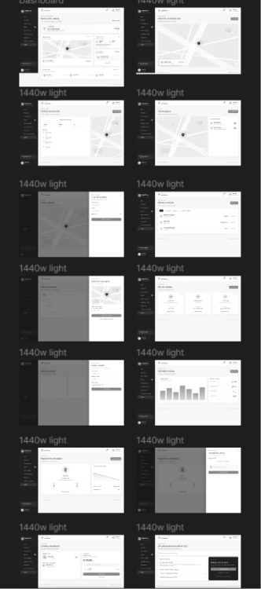

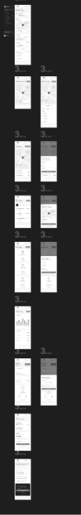

Enlace de Figma: [https://www.figma.com/design/pLuOIOdbg3TW0UyEd6vsbV/Sin-t%C3%ADtulo?node-id=0-1&t=hLhaWJL5PtuCYcnU-1](https://www.figma.com/design/pLuOIOdbg3TW0UyEd6vsbV/Sin-t%C3%ADtulo?node-id=0-1&t=hLhaWJL5PtuCYcnU-1)

### 4.4.2. Web Applications Wireflow Diagrams
Diagraman el recorrido de pantallas con estados condicionales para las metas críticas:
1. **Vinculación de Dispositivo IoT:** Apertura de LinkDeviceModalComponent → ingreso de código de emparejamiento → validación REST (POST /api/v1/devices/pair) → confirmación visual y actualización del estado a CONECTADA.
2. **Definición de Zona Segura:** Apertura de CreateSafeZoneModalComponent → ingreso de nombre, coordenadas y radio en metros → persistencia (POST /api/v1/safe-zones) → renderizado del perímetro circular verde en el mapa Leaflet.
3. **Gestión de Alertas de Riesgo:** Recepción de alerta automática por salida de zona segura (ZONE_EXIT) → visualización en AlertsViewComponent → inspección en AlertDetailModalComponent → cambio de estado (Atendida / Resuelta).

### 4.4.3. Web Applications Mock-ups
Los diseños finales implementados en la Web Application consolidan una interfaz serena en tonos verde bosque, blanco alabastro y coral:
* **Panel Principal:** Muestra el banner verde de seguridad, la hora de última actualización, el mapa interactivo Leaflet con el perímetro circular de la geocerca, el resumen de actividad diaria y la tarjeta de alerta reciente.
* **Módulos Especializados:** Vistas dedicadas para Ubicación, Zonas seguras, Alertas, Red de cuidado, Dispositivo y Cuenta y suscripción.

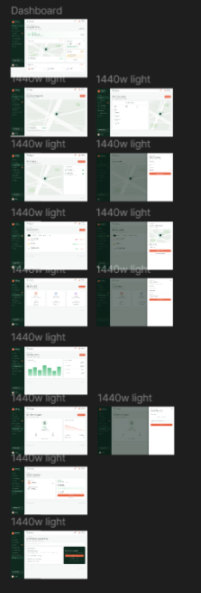

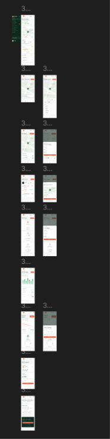

Enlace de Figma: [https://www.figma.com/design/pLuOIOdbg3TW0UyEd6vsbV/Sin-t%C3%ADtulo?node-id=0-1&t=hLhaWJL5PtuCYcnU-1](https://www.figma.com/design/pLuOIOdbg3TW0UyEd6vsbV/Sin-t%C3%ADtulo?node-id=0-1&t=hLhaWJL5PtuCYcnU-1)

### 4.4.4. Web Applications User Flow Diagrams
Definen el camino ideal (*Happy Path*) y las rutas alternativas de excepción (*Unhappy Paths*):
* *Flujo de Suscripción y Cambio de Plan:* Selección de plan -> confirmación con tarjeta guardada o formulario de tarjeta -> actualización en backend vs. manejo de errores de validación.
* *Flujo de Configuración de Geocerca:* Creación con coordenadas válidas y radio entre 50m y 10,000m vs. alerta de nombre duplicado o parámetros fuera de rango.
* *Flujo Reactivo de Telemetría y Alerta:* Envío de lectura GPS desde el dispositivo IoT -> evaluación continua de geocerca en backend -> generación automática de alerta -> visualización y atención por el cuidador.

## 4.5. Web Applications Prototyping

El prototipo interactivo de alta fidelidad fue desarrollado en **Figma**, simulando las transiciones de la Web Application y el flujo de navegación entre la Landing Page y los módulos de monitoreo, geocercas, dispositivos y suscripción.
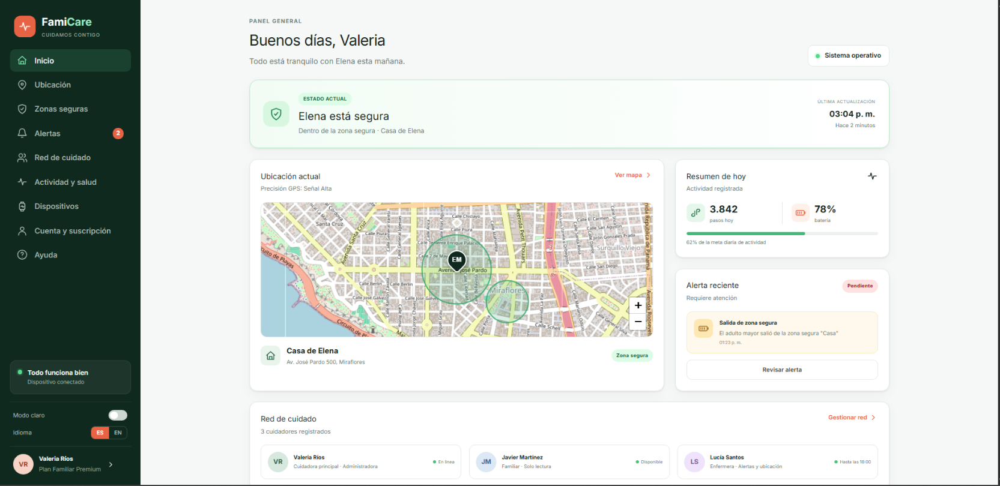
* **Enlace al video de navegación:** [https://upcedupe-my.sharepoint.com/:v:/g/personal/u202223405_upc_edu_pe/IQBaoUh8sEdoTqs4oqR7K4oQAafWpgzV6Qc7MeckEhWoV5k?nav=eyJyZWZlcnJhbEluZm8iOnsicmVmZXJyYWxBcHAiOiJPbmVEcml2ZUZvckJ1c2luZXNzIiwicmVmZXJyYWxBcHBQbGF0Zm9ybSI6IldlYiIsInJlZmVycmFsTW9kZSI6InZpZXciLCJyZWZlcnJhbFZpZXciOiJNeUZpbGVzTGlua0NvcHkifX0&e=6SSDuy](https://upcedupe-my.sharepoint.com/:v:/g/personal/u202223405_upc_edu_pe/IQBaoUh8sEdoTqs4oqR7K4oQAafWpgzV6Qc7MeckEhWoV5k?nav=eyJyZWZlcnJhbEluZm8iOnsicmVmZXJyYWxBcHAiOiJPbmVEcml2ZUZvckJ1c2luZXNzIiwicmVmZXJyYWxBcHBQbGF0Zm9ybSI6IldlYiIsInJlZmVycmFsTW9kZSI6InZpZXciLCJyZWZlcnJhbFZpZXciOiJNeUZpbGVzTGlua0NvcHkifX0&e=6SSDuy)

## 4.6. Domain-Driven Software Architecture

### 4.6.1. Design-Level Event Storming
A partir del análisis de eventos del negocio, la arquitectura se estructura en **5 Bounded Contexts** desacoplados que se comunican mediante eventos de dominio en Spring Boot:
1. **IoT Bounded Context (iot):** Gestiona el registro de dispositivos físicos (PENDING), vinculación a perfiles de adultos mayores (PAIRED) mediante PairingCode, nivel de batería (BatteryLevel) y recepción de telemetría (LOCATION, HEARTBEAT, PANIC, FALL), publicando TelemetryReceivedEvent.
2. **Zones Bounded Context (zones):** Modela las geocercas circulares (SafeZone con centro Coordinates y radio ZoneRadius), mantiene la última ubicación conocida (LastKnownLocation), escucha TelemetryReceivedEvent para evaluar transiciones de presencia (INSIDE / OUTSIDE) y publica SafeZoneEnteredEvent y SafeZoneExitedEvent.
3. **Monitor Bounded Context (monitor):** Gestiona el ciclo de vida de alertas de riesgo (Alert con estados PENDING, ATTENDED, RESOLVED y categorías ZONE_EXIT, LOW_BATTERY, INACTIVITY, SOS, FALL_DETECTED), registra el historial de ubicaciones (LocationRecord) y reacciona automáticamente a SafeZoneExitedEvent para generar alertas sin acoplar los dominios.
4. **Subscriptions Bounded Context (subscription):** Administra los planes de suscripción (FREE, FAMILIAR_PLUS, FAMILIAR_PREMIUM en moneda PEN), métodos de pago tokenizados (PaymentMethod), cambios de plan, cancelación al final del periodo (cancelAtPeriodEnd) y verificación programada de expiración (SubscriptionExpirationService).
5. **Care Bounded Context (care):** Modela las cuentas de cuidadores (administradores y colaboradores), perfiles de adultos mayores y la red de cuidado compartida (implementado a nivel de dominio/vista en el frontend y planificado para completar su integración backend en la siguiente iteración).

### 4.6.2. Software Architecture Context Diagram

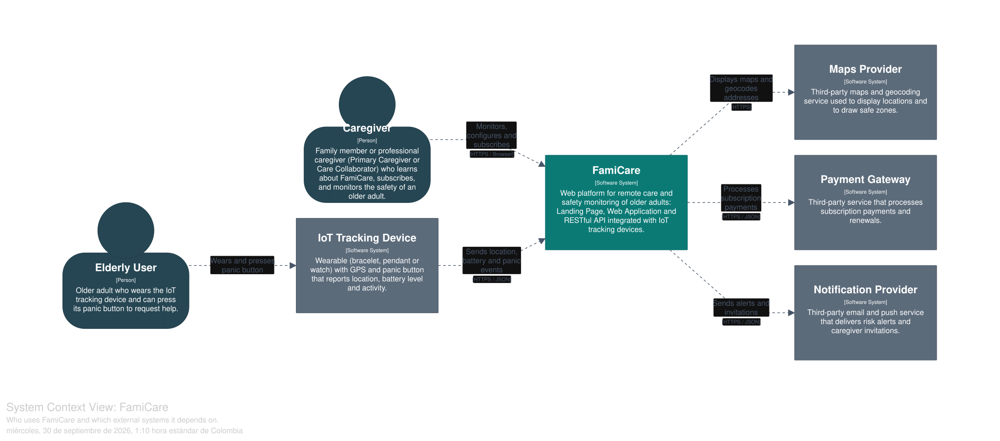

### 4.6.3. Software Architecture Container Diagrams

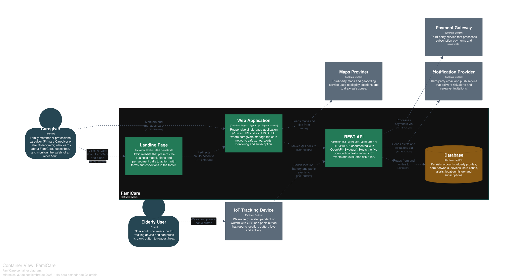

### 4.6.4. Software Architecture Components Diagrams

#### Care Bounded Context
##### Frontend:
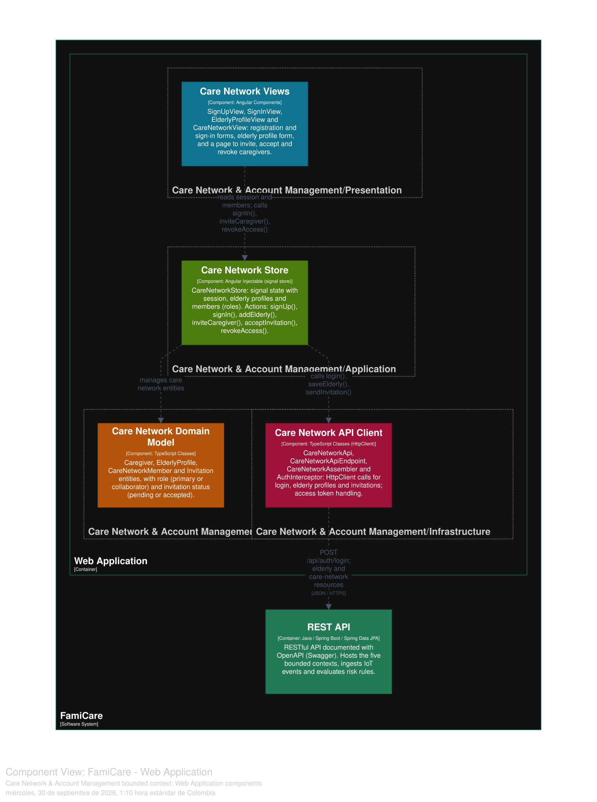

#### IOT Bounded Context
##### Frontend:
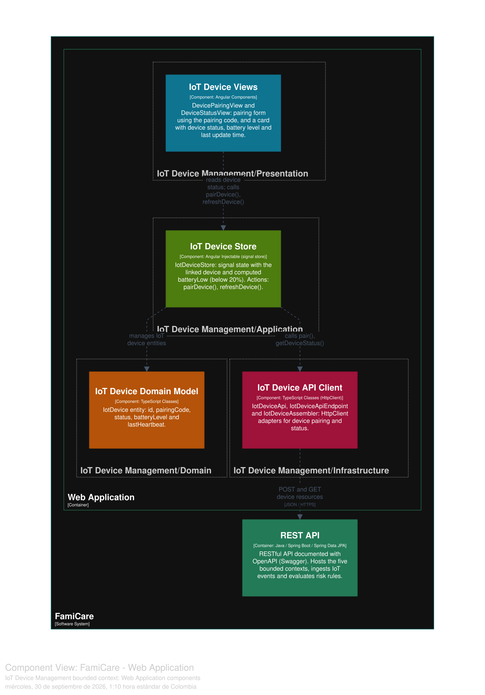

#### Monitor Bounded Context
##### Frontend:
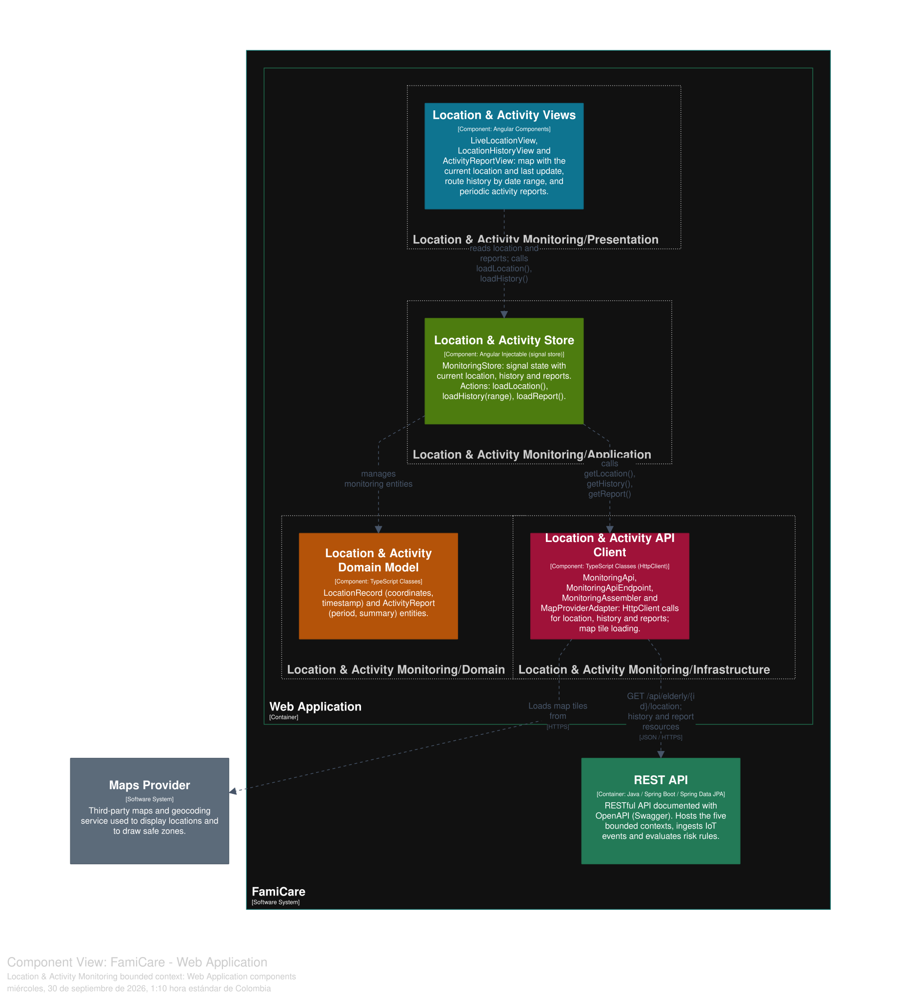

#### Subs Bounded Context
##### Frontend:
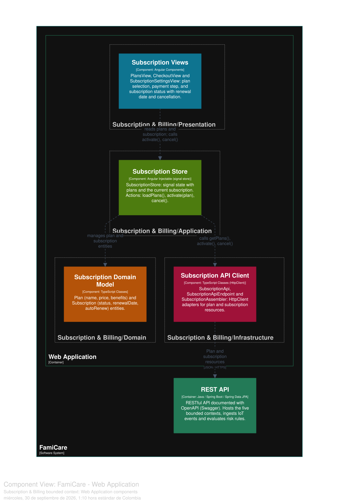

#### Zones Bounded Context
##### Frontend:
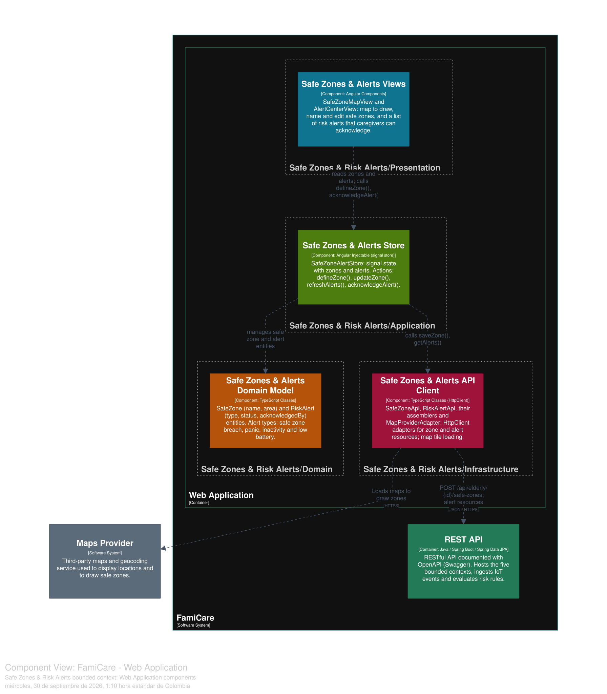

## 4.7. Software Object-Oriented Design

### 4.7.1. Class Diagrams
El diseño orientado a objetos del backend (Famicare-Backend en Java con Spring Boot y capas DDD: domain, application, infrastructure, interfaces) estructura los agregados y objetos de valor por Bounded Context:
* **IoT Context:** Agregados Device (id, pairingCode, elderlyProfileId, status, batteryLevel, lastHeartbeat, pairedAt) y TelemetryEvent (id, deviceId, eventType, latitude, longitude, batteryLevel, recordedAt, receivedAt), apoyados por los Value Objects PairingCode, BatteryLevel, Coordinates, DeviceStatus y TelemetryEventType.
* **Zones Context:** Agregados SafeZone (id, elderlyProfileId, name, centerLatitude, centerLongitude, radius, presence, lastEvaluatedAt) y LastKnownLocation (id, elderlyProfileId, latitude, longitude, recordedAt), con los Value Objects ZoneName, ZoneRadius, ZonePresence y Coordinates.
* **Monitor Context:** Agregados Alert (id, elderlyProfileId, type, category, title, description, status, attendedBy, createdAt, resolvedAt), LocationRecord (id, elderlyProfileId, latitude, longitude, accuracy, placeName, recordedAt) y MonitorTelemetryEvent.
* **Subscription Context:** Agregado Subscription (id, userId, planType, priceMonthly, currency, status, currentPeriodEnd, cancelAtPeriodEnd, cancelEffectiveDate) y Value Object embebido PaymentMethod (token, brand, lastFour, expirationMonth, expirationYear).
* **Care Context:** Entidades Caregiver (initials, name, role, availability, schedule) y perfil de adulto mayor (ElderlyProfile), actualmente soportadas en el frontend y pendientes de persistencia backend.

## 4.8. Database Design

### 4.8.1. Database Diagrams

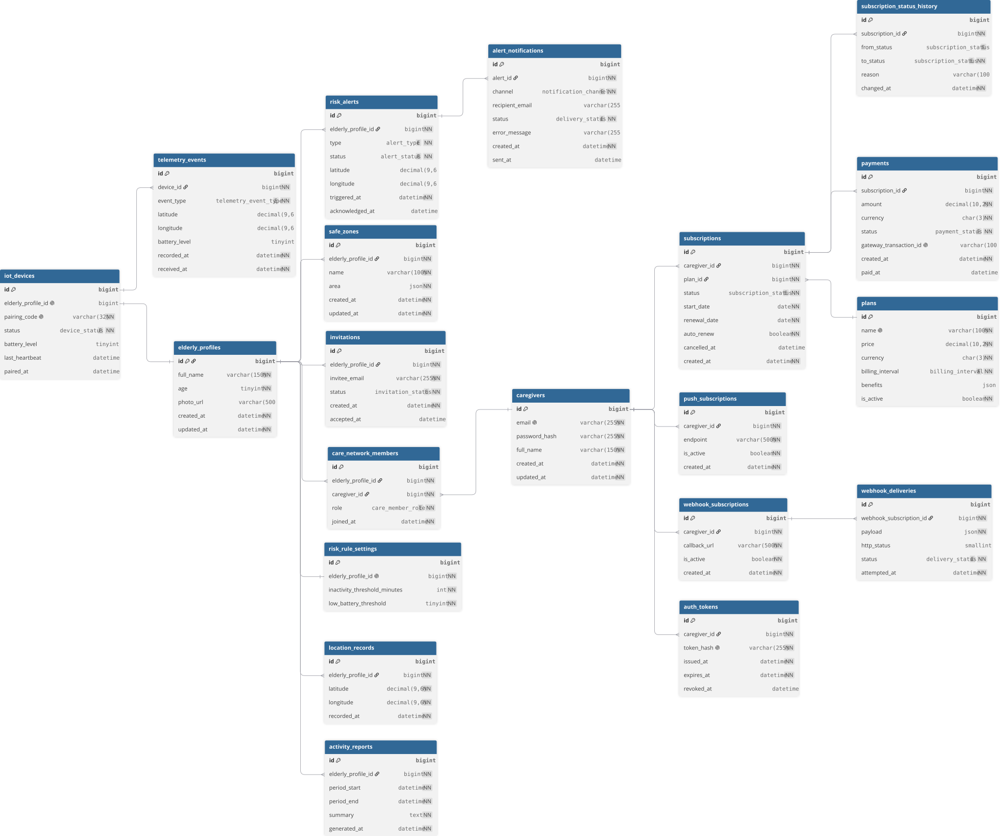
