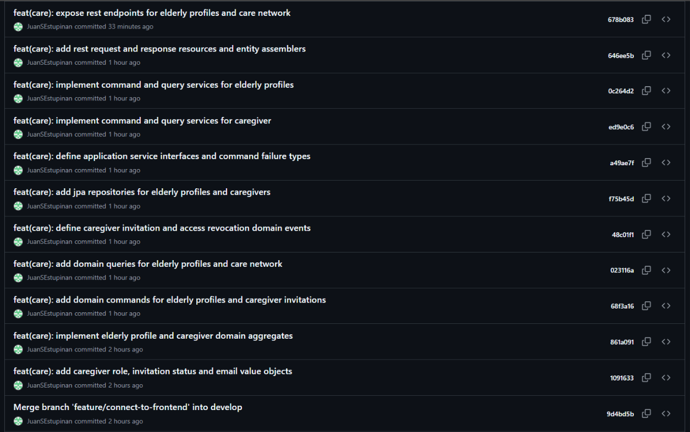
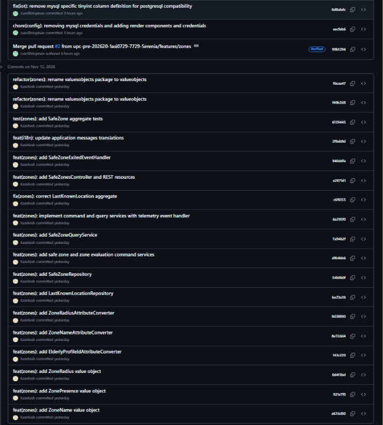
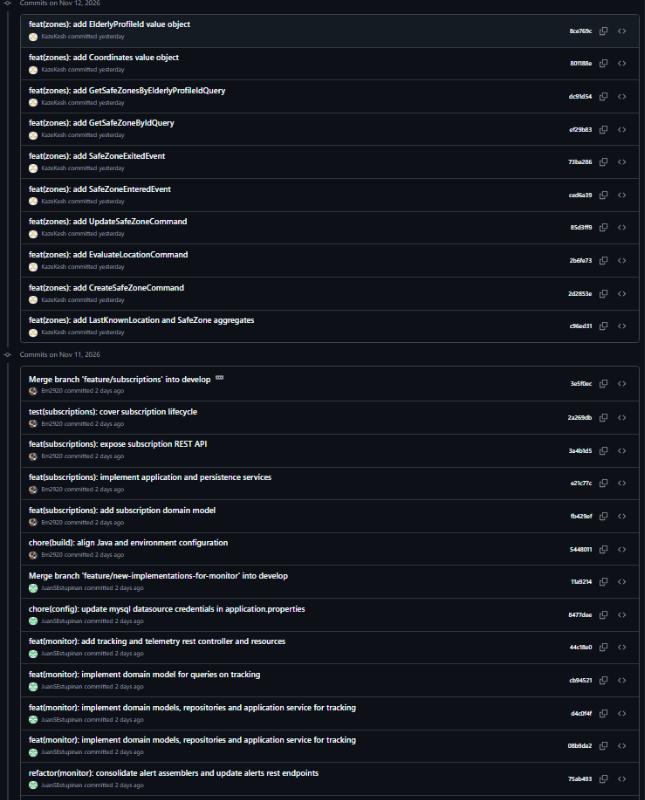
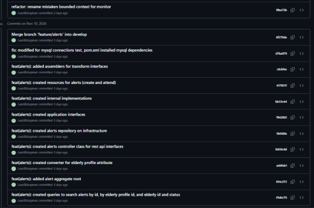
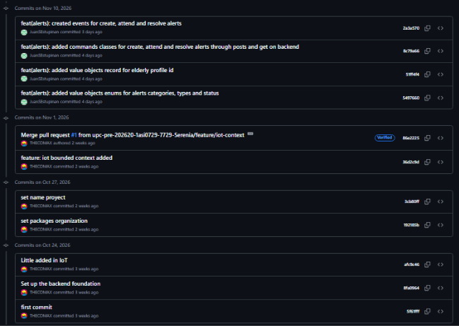
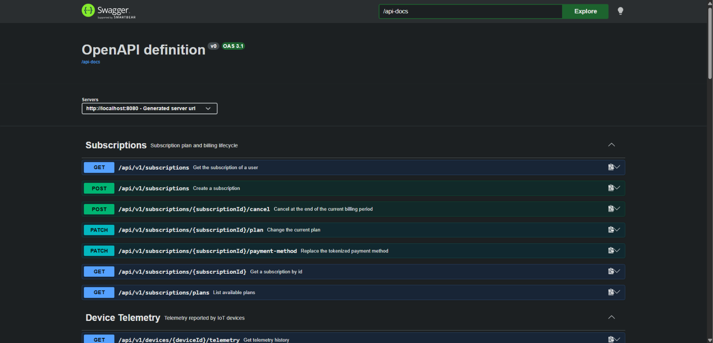
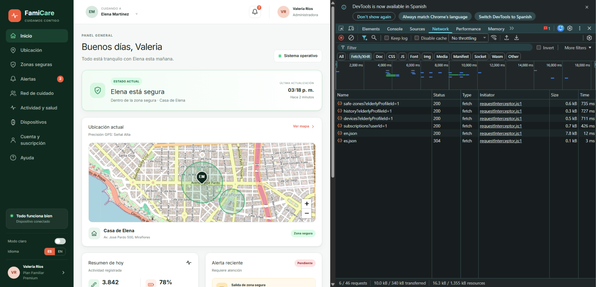
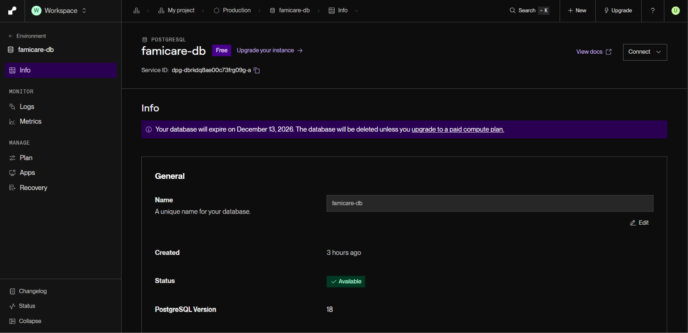
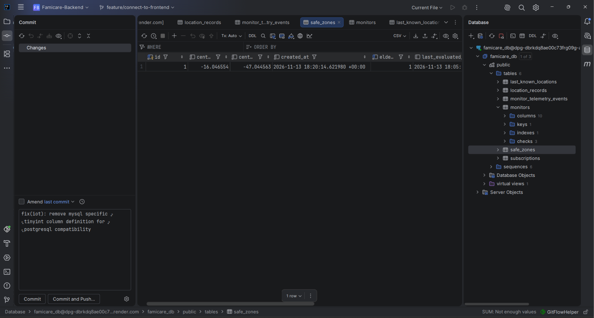

# Capítulo V: Product Implementation, Validation & Deployment

## 5.1. Software Configuration Management

### 5.1.1. Software Development Environment Configuration

| Actividad | Producto | Propósito de uso en el proyecto | Ruta de referencia / descarga |
| :--- | :--- | :--- | :--- |
| Project Management |GitHub|Organización y seguimiento de las actividades del proyecto.|[GitHub](https://github.com/)|
| Requirements Management |GitHub|Registro y seguimiento de los requerimientos del proyecto.|[GitHub](https://github.com/)|
| Product UX/UI Design |Figma, Miro, UXPressia|Diseño de interfaces y elaboración de herramientas de UX, como mapas de empatía, customer journey y otros artefactos de experiencia de usuario.|[Figma](https://www.figma.com/) / [Miro](https://miro.com/) / [UXPresia](https://uxpressia.com/)|
| Software Development | WebStorm, IntelliJ IDEA, Angular, TypeScript, Java, Spring Boot | Desarrollo de la aplicación web frontend y de los servicios RESTful backend con arquitectura DDD. | [WebStorm](https://www.jetbrains.com/webstorm/) / [IntelliJ IDEA](https://www.jetbrains.com/idea/) / [Spring Boot](https://spring.io/projects/spring-boot) |
| Database & Cloud Hosting | PostgreSQL, Render, GitHub Pages | Alojamiento de base de datos relacional administrada en la nube (Render) y despliegue web estático (GitHub Pages). | [Render](https://render.com/) / [PostgreSQL](https://www.postgresql.org/) / [GitHub Pages](https://pages.github.com/) |
| API Documentation & Testing | Swagger UI / OpenAPI 3 | Documentación interactiva y validación de endpoints RESTful. | [OpenAPI / Swagger](https://swagger.io/) |
| Software Deployment |GitHub Pages|Despliegue y publicación de la aplicación web.|[GitHub Pages](https://pages.github.com/)|
| Software Documentation |GitHub, Markdown|Elaboración, organización y almacenamiento de la documentación técnica del proyecto.|[GitHub Markdown](https://github.com/)|

### 5.1.2. Source Code Management

El proyecto utiliza **Git** como sistema de control de versiones y **GitHub** como plataforma para el almacenamiento, gestión y colaboración sobre los repositorios del equipo.

Los repositorios asociados a los productos desarrollados son los siguientes:

| **Producto** | **URL del repositorio en GitHub** |
|---|---|
| Landing Page | [Famicare-Landing-Page](https://github.com/upc-pre-202620-1asi0729-7729-Serenia/Famicare-Landing-Page) |
| Web Services (RESTful API — DDD) | [Famicare-Backend](https://github.com/upc-pre-202620-1asi0729-7729-Serenia/Famicare-Backend) |
| Frontend Web Applications | [Famicare-Frontend](https://github.com/upc-pre-202620-1asi0729-7729-Serenia/Famicare-Frontend) |

### GitFlow

Para organizar el desarrollo del proyecto se establece el uso de **GitFlow**, considerando las ramas main y develop como ramas principales, además de ramas temporales destinadas al desarrollo de funcionalidades, preparación de versiones y correcciones urgentes.

La rama main contiene las versiones estables del proyecto, mientras que develop concentra los cambios que se encuentran en desarrollo antes de ser incorporados a una versión estable.

Para el desarrollo de nuevas funcionalidades se utilizan ramas con la siguiente nomenclatura:

text
feature/<nombre-de-la-funcionalidad>

### 5.1.3. Source Code Style Guide & Conventions

El proyecto establece convenciones de nomenclatura y estilo de código con el objetivo de mantener una base de código consistente, legible y fácil de mantener. Los nombres utilizados en el código se mantienen en **inglés**, siguiendo las convenciones recomendadas por las tecnologías y frameworks utilizados en el proyecto.

| Tecnología | Guía / referencia | Convenciones principales |
|---|---|---|
| HTML | [Google HTML/CSS Style Guide](https://google.github.io/styleguide/htmlcssguide.html) | Uso de HTML semántico, indentación consistente y atributos en minúsculas. |
| CSS | [Google HTML/CSS Style Guide](https://google.github.io/styleguide/htmlcssguide.html) | Nombres descriptivos, organización consistente de estilos y uso de minúsculas. |
| TypeScript | [Angular Style Guide](https://angular.dev/style-guide) | camelCase para variables y métodos, PascalCase para clases y componentes, nombres descriptivos en inglés. |
| Java | [Google Java Style Guide](https://google.github.io/styleguide/javaguide.html) | camelCase para variables y métodos, PascalCase para clases e interfaces y nombres descriptivos en inglés. |
| Gherkin | [Gherkin Reference](https://cucumber.io/docs/gherkin/reference/) | Estructuración de escenarios mediante Feature, Scenario, Given, When y Then. |
| Spring Boot | [Spring Boot Documentation](https://docs.spring.io/spring-boot/) | Organización del proyecto mediante las convenciones y anotaciones proporcionadas por Spring Boot. |

### Naming Conventions

Para mantener una nomenclatura uniforme, se establecen las siguientes convenciones:

- Los nombres de variables, métodos, clases, componentes y archivos deben utilizar palabras en **inglés**.
- Las variables y métodos utilizan **camelCase**.
- Las clases, interfaces y componentes utilizan **PascalCase**.
- Los nombres deben ser descriptivos y representar claramente su propósito.
- Se evitarán nombres ambiguos o abreviaturas innecesarias.

### 5.1.4. Software Deployment Configuration

El despliegue de los productos digitales de Famicare se realiza utilizando **GitHub Pages**, permitiendo publicar las aplicaciones web directamente a partir de los repositorios de código fuente alojados en GitHub.

Actualmente, la solución contempla el despliegue de la **Landing Page** y la **Frontend Web Application**. Los **Web Services** aún no cuentan con un repositorio ni un despliegue implementado.

### Landing Page

La Landing Page se encuentra alojada en el repositorio [Famicare-Landing-Page](https://github.com/upc-pre-202620-1asi0729-7729-Serenia/Famicare-Landing-Page) y su publicación se realiza mediante GitHub Pages.

Los pasos generales para realizar el despliegue son:

1. Clonar el repositorio de la Landing Page:

bash
git clone https://github.com/upc-pre-202620-1asi0729-7729-Serenia/Famicare-Landing-Page.git

2. Ingresar al directorio del proyecto:

bash
cd Famicare-Landing-Page

3. Instalar las dependencias necesarias, en caso de que el proyecto las utilice:

bash
npm install

4. Realizar los cambios correspondientes en el código fuente.
5. Registrar y enviar los cambios al repositorio:

bash
git add .
git commit -m "docs: update landing page"
git push

6. Configurar GitHub Pages en el repositorio, seleccionando la rama y carpeta correspondientes al contenido que será publicado.
7. GitHub Pages genera y publica la versión disponible de la Landing Page mediante una URL pública.

### Frontend Web Application
La Frontend Web Application se encuentra alojada en el repositorio [Famicare-Frontend](https://github.com/upc-pre-202620-1asi0729-7729-Serenia/Famicare-Frontend) y utiliza Angular y TypeScript para su desarrollo.

Los pasos generales para realizar el despliegue son:

1. Clonar el repositorio:
bash
git clone https://github.com/upc-pre-202620-1asi0729-7729-Serenia/Famicare-Frontend.git

2. Ingresar al directorio del proyecto:
bash
cd Famicare-Frontend

3. Instalar las dependencias del proyecto:
bash
npm install

4. Ejecutar la aplicación localmente para verificar su funcionamiento:
bash
ng serve

5. Generar la versión de producción:
bash
ng build

6. Configurar el repositorio para que el contenido generado sea publicado mediante GitHub Pages.
7. Publicar los cambios en el repositorio:
bash
git add .
git commit -m "feat: update frontend application"
git push

8. GitHub Pages publica la aplicación generada y permite acceder a ella mediante una URL pública.

## 5.2. Landing Page, Services & Applications Implementation

### 5.2.1. Sprint 1

#### 5.2.1.1. Sprint Planning 1

| Sprint # | Sprint 1 |
| :--- | :--- |
| **Sprint Planning Background** | |
| Date | 2026-08-29 |
| Time | 4:00 PM |
| Location | Teams |
| Prepared By | Estupiñan Olortegui, Juan Sebastián	U202223405 |
| Attendees (to planning meeting) | Arroyo Gonzales, Emily Juliette	U202311469 Atoche Gonzales, Nicolas Fernando	U20241d317 Estupiñan Olortegui, Juan Sebastián	U202223405 Razuri Ucañan, Piero Alejandro	U202213484 Yauri Barrios, Antony David	U202214499 |
| Previous Sprint Review Summary | No aplica para el Sprint 1. |
| Previous Sprint Retrospective Summary | No aplica para el Sprint 1. |
| **Sprint Goal & User Stories** | |
| Sprint 1 Goal | Nuestro enfoque es establecer la base inicial de la plataforma FamiCare mediante la implementación de la gestión de cuentas de cuidadores y el registro del perfil del adulto mayor. Consideramos que esto proporciona la funcionalidad básica necesaria para que los cuidadores comiencen a utilizar la plataforma. Esto se confirmará cuando los cuidadores puedan registrarse, iniciar sesión y crear correctamente un perfil de adulto mayor.
| Sprint 1 Velocity | 13 |
| Sum of Story Points | 13 |

#### 5.2.1.2. Aspect Leaders and Collaborators

| Team Member (Last Name, First Name) | GitHub Username | Account Management — Leader (L) / Collaborator (C) | Authentication — Leader (L) / Collaborator (C) | Elderly Profile Management — Leader (L) / Collaborator (C) | Frontend / UI — Leader (L) / Collaborator (C)|
| :--- | :--- | :---: | :---: | :---: | :---: |
| Arroyo Gonzales, Emily Juliette |[Em2920](https://github.com/Em2920)|C |C |C |C |
| Atoche Gonzales, Nicolas Fernando |[THECOMAX](https://github.com/THECOMAX)|L |L |L |L |
| Estupiñan Olortegui, Juan Sebastián |[JuanSEstupinan](https://github.com/JuanSEstupinan)| C| C| C| C|
| Razuri Ucañan, Piero Alejandro |[PieroR29](https://github.com/PieroR29)| C|C |C |C |
| Yauri Barrios, Antony David |[KazeKesh](https://github.com/KazeKesh)| C|C |C |C |

#### 5.2.1.3. Sprint Backlog 1

| **Story Id** | **Story Title**                    | **Task Id** | **Task Title**                         | **Task Description**                                                                                        | **Estimation (Hours)** | **Assigned To**                        | **Status**    |
| ------------ | ---------------------------------- | ----------- | -------------------------------------- | ----------------------------------------------------------------------------------------------------------- | ---------------------: | -------------------------------------- | ------------- |
| **US-01**    | Registro de cuidador administrador | TASK-01     | Diseñar formulario de registro         | Crear la interfaz del formulario para registrar los datos del cuidador administrador.                       |                      2 | **Emily Juliette Arroyo Gonzales**     | **Done**      |
| **US-01**    | Registro de cuidador administrador | TASK-02     | Implementar validación de datos        | Validar campos obligatorios, formato de correo, contraseña y confirmación de contraseña.                    |                      2 | **Nicolas Fernando Atoche Gonzales**   | **Done**      |
| **US-01**    | Registro de cuidador administrador | TASK-03     | Implementar servicio de registro       | Desarrollar la lógica para enviar los datos del formulario al backend y registrar al cuidador.              |                      3 | **Antony David Yauri Barrios**         | **InProcess** |
| **US-01**    | Registro de cuidador administrador | TASK-04     | Persistencia del cuidador              | Implementar el almacenamiento de la información del cuidador administrador en la base de datos.             |                      3 | **Juan Sebastián Estupiñan Olortegui** | **To-do**     |
| **US-01**    | Registro de cuidador administrador | TASK-05     | Pruebas de registro                    | Verificar el registro correcto y los casos de error, como correo existente o datos inválidos.               |                      2 | **Piero Alejandro Razuri Ucañán**      | **To-do**     |
| **US-02**    | Inicio de sesión                   | TASK-06     | Diseñar formulario de inicio de sesión | Crear la interfaz para ingresar correo y contraseña.                                                        |                      2 | **Emily Juliette Arroyo Gonzales**     | **Done**      |
| **US-02**    | Inicio de sesión                   | TASK-07     | Implementar autenticación              | Implementar la lógica para validar las credenciales del cuidador mediante el backend.                       |                      3 | **Antony David Yauri Barrios**         | **InProcess** |
| **US-02**    | Inicio de sesión                   | TASK-08     | Gestionar sesión de usuario            | Implementar el manejo de la sesión o token del cuidador autenticado.                                        |                      2 | **Juan Sebastián Estupiñan Olortegui** | **To-do**     |
| **US-02**    | Inicio de sesión                   | TASK-09     | Manejar errores de autenticación       | Mostrar mensajes cuando las credenciales sean incorrectas o exista un problema durante el inicio de sesión. |                      1 | **Piero Alejandro Razuri Ucañán**      | **ToReview**  |
| **US-03**    | Agregar adulto mayor al perfil     | TASK-10     | Diseñar formulario de adulto mayor     | Crear la interfaz para registrar la información básica del adulto mayor.                                    |                      2 | **Nicolas Fernando Atoche Gonzales**   | **Done**      |
| **US-03**    | Agregar adulto mayor al perfil     | TASK-11     | Implementar validación de datos        | Validar los campos requeridos y formatos de los datos del adulto mayor.                                     |                      2 | **Emily Juliette Arroyo Gonzales**     | **InProcess** |
| **US-03**    | Agregar adulto mayor al perfil     | TASK-12     | Implementar registro de adulto mayor   | Desarrollar la lógica para asociar y guardar un adulto mayor dentro del perfil del cuidador.                |                      3 | **Nicolas Fernando Atoche Gonzales**   | **To-do**     |
| **US-03**    | Agregar adulto mayor al perfil     | TASK-13     | Persistencia y relación de datos       | Configurar la relación entre el cuidador administrador y el adulto mayor en la base de datos.               |                      3 | **Juan Sebastián Estupiñan Olortegui** | **To-do**     |
| **US-03**    | Agregar adulto mayor al perfil     | TASK-14     | Pruebas de registro de adulto mayor    | Verificar que el adulto mayor se registre correctamente y quede asociado al cuidador correspondiente.       |                      2 | **Piero Alejandro Razuri Ucañán**      | **To-do**     |

#### 5.2.1.4. Development Evidence for Sprint Review

| Repository | Branch | Commit Id | Commit Message | Commit Message Body | Commited on (Date) |
| :--- | :--- | :---: | :--- | :--- | :---: |
|https://github.com/upc-pre-202620-1asi0729-7729-Serenia/Famicare-Frontend.git|main|59399d9|feature: frontend|-|05/10/2026 |

#### 5.2.1.5. Execution Evidence for Sprint Review

Durante el Sprint 1 se implementaron las funcionalidades correspondientes al registro
del cuidador administrador, inicio de sesión y registro de adultos mayores asociados
al perfil del cuidador. Estas funcionalidades permiten establecer la gestión inicial
de cuentas y la creación de la red de cuidado dentro de la solución.

A continuación, se presentan capturas de las principales vistas implementadas durante
el Sprint, mostrando la navegación y ejecución de las funcionalidades desarrolladas.

### Registro de cuidador administrador
La vista permite al cuidador administrador ingresar sus datos personales y credenciales
para crear una cuenta dentro de la plataforma.

### Inicio de sesión

La vista permite al cuidador registrado autenticarse mediante sus credenciales y acceder
a las funcionalidades correspondientes de la plataforma.

### Registro de adulto mayor
La vista permite al cuidador administrador registrar y asociar un adulto mayor a su
perfil, ingresando la información solicitada por el sistema.

### Video de demostración

El siguiente video presenta la ejecución y navegación de las funcionalidades desarrolladas
durante el Sprint 1:

[Video de demostracion.mp4](assets/readme/sprint/Video%20de%20demostracion.mp4)

#### 5.2.1.6. Services Documentation Evidence for Sprint Review

urante el Sprint 1 se implementaron los Web Services necesarios para soportar las
funcionalidades de registro del cuidador administrador e inicio de sesión. Estos
servicios permiten registrar nuevos usuarios y autenticar a los cuidadores
registrados en la plataforma.

La documentación de los servicios presenta el método HTTP, los datos requeridos
para cada solicitud y la estructura de las respuestas esperadas.

### Endpoints documentados

| Endpoint | Método HTTP | Acción | Descripción |
|---|---|---|---|
| /register | POST | Registrar cuidador | Registra un nuevo cuidador administrador mediante los datos proporcionados. |
| /login | POST | Iniciar sesión | Autentica al cuidador mediante sus credenciales de acceso. |

### POST /register

**URL local:**

http://localhost:4200/register

**Método HTTP:** POST

**Descripción:**  
Permite registrar un nuevo cuidador administrador en la plataforma.

#### 5.2.1.7. Software Deployment Evidence for Sprint Review

Durante el Sprint 1 no se realizó un despliegue de la solución en un entorno de
producción o en un proveedor de servicios cloud. Las funcionalidades desarrolladas
durante este Sprint fueron ejecutadas y validadas únicamente en un entorno local
de desarrollo.

La ejecución local permitió al equipo verificar el funcionamiento de las
funcionalidades correspondientes al registro del cuidador administrador y al inicio
de sesión, así como validar la navegación y comportamiento de las vistas
implementadas.

### Entorno de desarrollo local

Durante el Sprint se utilizó el entorno local para ejecutar y validar la aplicación.
Las principales rutas utilizadas para la validación fueron:

| Componente | URL local | Estado |
|---|---|---|
| Web Application - Registro | http://localhost:4200/register | Implementado y probado localmente |
| Web Application - Inicio de sesión | http://localhost:4200/login | Implementado y probado localmente |

#### 5.2.1.8. Team Collaboration Insights during Sprint

Durante el Sprint 1, el equipo trabajó colaborativamente en la implementación de
las funcionalidades relacionadas con la gestión inicial de cuentas y la red de
cuidado de FamiCare. Las actividades fueron distribuidas entre los integrantes
considerando las tareas definidas en el Sprint Backlog.

### Actividades realizadas por los integrantes

| Alumno | Actividad |
|---|---|
| Arroyo Gonzales, Emily Juliette | Diseño e implementación de las interfaces de registro e inicio de sesión, además de validaciones de formularios. |
| Atoche Gonzales, Nicolas Fernando | Implementación de funcionalidades relacionadas con el registro y gestión de datos del adulto mayor. |
| Estupiñan Olortegui, Juan Sebastián | Implementación de la persistencia y relación de datos entre el cuidador y el adulto mayor. |
| Razuri Ucañán, Piero Alejandro | Desarrollo de pruebas y validación de las funcionalidades de autenticación y registro. |
| Yauri Barrios, Antony David | Implementación de servicios relacionados con el registro y autenticación de usuarios. |

### Colaboración mediante Git

El desarrollo del Sprint se realizó utilizando Git y GitHub como herramientas de
control de versiones y colaboración. Los integrantes trabajaron sobre el
repositorio del proyecto, realizando commits asociados a las funcionalidades,
correcciones y documentación desarrolladas durante el Sprint.

### Identificación de integrantes

| Username (GitHub) | Nombre |
|---|---|
| Em2920 | Arroyo Gonzales, Emily Juliette |
| THECOMAX | Atoche Gonzales, Nicolas Fernando |
| JuanSEstupinan | Estupiñan Olortegui, Juan Sebastián |
| PieroR29 | Razuri Ucañán, Piero Alejandro |
| KazeKesh | Yauri Barrios, Antony David |

### 5.2.1. Sprint 2

#### 5.2.1.1. Sprint Planning 2

| Sprint #                              | Sprint 2                                                                                                                                                                                                                                                                                                                                                                                                                                                                                                                                                  |
| :------------------------------------ | :-------------------------------------------------------------------------------------------------------------------------------------------------------------------------------------------------------------------------------------------------------------------------------------------------------------------------------------------------------------------------------------------------------------------------------------------------------------------------------------------------------------------------------------------------------- |
| **Sprint Planning Background**        |                                                                                                                                                                                                                                                                                                                                                                                                                                                                                                                                                           |
| Date                                  | 2026-10-03                                                                                                                                                                                                                                                                                                                                                                                                                                                                                                                                                |
| Time                                  | 4:00 PM                                                                                                                                                                                                                                                                                                                                                                                                                                                                                                                                                   |
| Location                              | Teams                                                                                                                                                                                                                                                                                                                                                                                                                                                                                                                                                     |
| Prepared By                           | Estupiñan Olortegui, Juan Sebastián U202223405                                                                                                                                                                                                                                                                                                                                                                                                                                                                                                            |
| Attendees (to planning meeting)       | Arroyo Gonzales, Emily Juliette U202311469 Atoche Gonzales, Nicolas Fernando U20241d317 Estupiñan Olortegui, Juan Sebastián U202223405 Razuri Ucañan, Piero Alejandro U202213484 Yauri Barrios, Antony David U202214499                                                                                                                                                                                                                                                                                                                   |
| Previous Sprint Review Summary        | Durante el Sprint 1 se implementaron las funcionalidades correspondientes al registro del cuidador administrador, inicio de sesión y registro del adulto mayor asociado al perfil del cuidador.                                                                                                                                                                                                                                                                                                                                                           |
| Previous Sprint Retrospective Summary | El equipo logró establecer la base funcional de la Web Application y distribuir las actividades mediante Git y GitHub. Para el siguiente Sprint se continuará con las funcionalidades de monitoreo, seguridad y gestión de la red de cuidado.                                                                                                                                                                                                                                                                                                             |
| **Sprint Goal & User Stories**        |                                                                                                                                                                                                                                                                                                                                                                                                                                                                                                                                                           |
| Sprint 2 Goal                         | Nuestro enfoque es ampliar la plataforma FamiCare mediante la implementación de las funcionalidades de monitoreo y seguridad del adulto mayor. Se busca permitir que los cuidadores administren la red de cuidado, vinculen, gestionen zonas seguras, consulten alertas, visualicen la ubicación y actividad del adulto mayor y gestionen el plan de suscripción. Esto se confirmará cuando los cuidadores puedan utilizar las vistas correspondientes para administrar y monitorear al adulto mayor desde la plataforma. |
| Sprint 2 Velocity                     | 34                                                                                                                                                                                                                                                                                                                                                                                                                                                                                                                                                        |
| Sum of Story Points                   | 34                                                                                                                                                                                                                                                                                                                                                                                                                                                                                                                                                        |

#### 5.2.2.2. Aspect Leaders and Collaborators

| Team Member (Last Name, First Name) | GitHub Username                                     | Care Network — Leader (L) / Collaborator (C) | IoT Device — Leader (L) / Collaborator (C) | Safe Zones & Alerts — Leader (L) / Collaborator (C) | Location & Activity — Leader (L) / Collaborator (C) | Subscription — Leader (L) / Collaborator (C) | Frontend / UI — Leader (L) / Collaborator (C) |
| :---------------------------------- | :-------------------------------------------------- | :------------------------------------------: | :----------------------------------------: | :-------------------------------------------------: | :-------------------------------------------------: | :------------------------------------------: | :-------------------------------------------: |
| Arroyo Gonzales, Emily Juliette     | [Em2920](https://github.com/Em2920)                 |                       C                      |                      C                     |                          C                          |                          C                          |                       C                      |                       C                       |
| Atoche Gonzales, Nicolas Fernando   | [THECOMAX](https://github.com/THECOMAX)             |                       L                      |                      L                     |                          L                          |                          L                          |                       L                      |                       L                       |
| Estupiñan Olortegui, Juan Sebastián | [JuanSEstupinan](https://github.com/JuanSEstupinan) |                       C                      |                      C                     |                          C                          |                          C                          |                       C                      |                       C                       |
| Razuri Ucañan, Piero Alejandro      | [PieroR29](https://github.com/PieroR29)             |                       C                      |                      C                     |                          C                          |                          C                          |                       C                      |                       C                       |
| Yauri Barrios, Antony David         | [KazeKesh](https://github.com/KazeKesh)             |                       C                      |                      C                     |                          C                          |                          C                          |                       C                      |                       C                       |

#### 5.2.2.3. Sprint Backlog 2

| **Story Id** | **Story Title**                        | **Task Id** | **Task Title**                        | **Task Description**                                                                                          | **Estimation (Hours)** | **Assigned To**                        | **Status** |
| ------------ | -------------------------------------- | ----------- | ------------------------------------- | ------------------------------------------------------------------------------------------------------------- | ---------------------: | -------------------------------------- | ---------- |
| **US-04**    | Invitar cuidador a la red de cuidado   | TASK-15     | Diseñar interfaz de invitación        | Crear la interfaz para ingresar el correo electrónico del cuidador que será invitado.                         |                      2 | **Emily Juliette Arroyo Gonzales**     | **Done**   |
| **US-04**    | Invitar cuidador a la red de cuidado   | TASK-16     | Implementar envío de invitación       | Implementar la lógica para registrar y enviar la invitación al cuidador colaborador.                          |                      3 | **Antony David Yauri Barrios**         | **Done**   |
| **US-05**    | Aceptar invitación a la red de cuidado | TASK-17     | Diseñar gestión de invitaciones       | Crear la interfaz para visualizar y aceptar invitaciones pendientes.                                          |                      2 | **Emily Juliette Arroyo Gonzales**     | **Done**   |
| **US-05**    | Aceptar invitación a la red de cuidado | TASK-18     | Implementar aceptación de invitación  | Implementar la lógica para aceptar la invitación y otorgar acceso como colaborador.                           |                      3 | **Juan Sebastián Estupiñan Olortegui** | **Done**   |
| **US-06**    | Revocar acceso de un colaborador       | TASK-19     | Diseñar lista de colaboradores        | Crear la interfaz para visualizar los cuidadores colaboradores asociados al adulto mayor.                     |                      2 | **Piero Alejandro Razuri Ucañán**      | **Done**   |
| **US-06**    | Revocar acceso de un colaborador       | TASK-20     | Implementar revocación de acceso      | Implementar la lógica para eliminar el acceso de un cuidador colaborador.                                     |                      2 | **Nicolas Fernando Atoche Gonzales**   | **Done**   |
| **US-07**    | Vincular dispositivo IoT               | TASK-21     | Diseñar vinculación del dispositivo   | Crear la interfaz para ingresar el código de emparejamiento del dispositivo IoT.                              |                      2 | **Emily Juliette Arroyo Gonzales**     | **Done**   |
| **US-07**    | Vincular dispositivo IoT               | TASK-22     | Implementar vinculación IoT           | Implementar la lógica para asociar el dispositivo al adulto mayor.                                            |                      3 | **Nicolas Fernando Atoche Gonzales**   | **Done**   |
| **US-08**    | Visualizar nivel de batería            | TASK-23     | Mostrar estado del dispositivo        | Implementar la visualización del estado y porcentaje de batería del dispositivo IoT.                          |                      2 | **Antony David Yauri Barrios**         | **Done**   |
| **US-09**    | Alerta de batería baja                 | TASK-24     | Implementar indicador de batería baja | Mostrar una alerta cuando el nivel de batería del dispositivo se encuentre por debajo del umbral establecido. |                      2 | **Piero Alejandro Razuri Ucañán**      | **Done**   |
| **US-10**    | Definir zona segura                    | TASK-25     | Diseñar gestión de zonas seguras      | Crear la interfaz para registrar una nueva zona segura sobre el mapa.                                         |                      3 | **Nicolas Fernando Atoche Gonzales**   | **Done**   |
| **US-10**    | Definir zona segura                    | TASK-26     | Implementar creación de zona          | Implementar la lógica para guardar el nombre y área de una zona segura.                                       |                      3 | **Juan Sebastián Estupiñan Olortegui** | **Done**   |
| **US-11**    | Editar zona segura                     | TASK-27     | Implementar edición de zona           | Permitir modificar el nombre y área de una zona segura existente.                                             |                      2 | **Emily Juliette Arroyo Gonzales**     | **Done**   |
| **US-12**    | Alerta de salida de zona segura        | TASK-28     | Implementar alerta de salida          | Mostrar una alerta cuando la ubicación del adulto mayor se encuentre fuera de una zona segura.                |                      2 | **Piero Alejandro Razuri Ucañán**      | **Done**   |
| **US-13**    | Botón de pánico                        | TASK-29     | Diseñar alerta de emergencia          | Crear la interfaz para visualizar y gestionar una alerta de emergencia generada desde el dispositivo.         |                      2 | **Nicolas Fernando Atoche Gonzales**   | **Done**   |
| **US-13**    | Botón de pánico                        | TASK-30     | Implementar notificación de pánico    | Implementar la generación y visualización de la alerta de emergencia para los cuidadores.                     |                      3 | **Antony David Yauri Barrios**         | **Done**   |
| **US-14**    | Alerta de inactividad prolongada       | TASK-31     | Implementar detección de inactividad  | Implementar la lógica para detectar periodos prolongados sin movimiento.                                      |                      3 | **Juan Sebastián Estupiñan Olortegui** | **Done**   |
| **US-14**    | Alerta de inactividad prolongada       | TASK-32     | Mostrar alerta de inactividad         | Mostrar la alerta correspondiente en la sección de alertas de la plataforma.                                  |                      2 | **Emily Juliette Arroyo Gonzales**     | **Done**   |
| **US-16**    | Ubicación en tiempo real               | TASK-33     | Diseñar mapa de ubicación             | Crear la interfaz del mapa para mostrar la ubicación actual del adulto mayor.                                 |                      3 | **Nicolas Fernando Atoche Gonzales**   | **Done**   |
| **US-16**    | Ubicación en tiempo real               | TASK-34     | Implementar ubicación actual          | Integrar la información del dispositivo para mostrar las coordenadas actuales del adulto mayor.               |                      3 | **Antony David Yauri Barrios**         | **Done**   |
| **US-17**    | Historial de ubicación                 | TASK-35     | Diseñar historial de recorridos       | Crear la interfaz para seleccionar un rango de fechas y consultar ubicaciones anteriores.                     |                      2 | **Emily Juliette Arroyo Gonzales**     | **Done**   |
| **US-17**    | Historial de ubicación                 | TASK-36     | Implementar historial de ubicación    | Mostrar el recorrido registrado del adulto mayor durante el periodo seleccionado.                             |                      3 | **Juan Sebastián Estupiñan Olortegui** | **Done**   |
| **US-18**    | Reporte de actividad                   | TASK-37     | Diseñar vista de actividad            | Crear la interfaz para consultar la actividad registrada del adulto mayor.                                    |                      2 | **Piero Alejandro Razuri Ucañán**      | **Done**   |
| **US-18**    | Reporte de actividad                   | TASK-38     | Implementar reporte de actividad      | Implementar la visualización de los datos de actividad y sus patrones registrados.                            |                      3 | **Nicolas Fernando Atoche Gonzales**   | **Done**   |
| **US-19**    | Activar suscripción                    | TASK-39     | Diseñar sección de planes             | Crear la interfaz para visualizar los planes de suscripción disponibles y sus beneficios.                     |                      2 | **Emily Juliette Arroyo Gonzales**     | **Done**   |
| **US-19**    | Activar suscripción                    | TASK-40     | Implementar activación de plan        | Implementar el flujo para seleccionar y activar un plan de suscripción.                                       |                      3 | **Antony David Yauri Barrios**         | **Done**   |
| **US-20**    | Renovar suscripción                    | TASK-41     | Configurar renovación automática      | Implementar la configuración de renovación automática de la suscripción.                                      |                      2 | **Juan Sebastián Estupiñan Olortegui** | **Done**   |
| **US-21**    | Cancelar suscripción                   | TASK-42     | Implementar cancelación de plan       | Permitir al cuidador administrador cancelar su suscripción y detener la renovación automática.                |                      2 | **Piero Alejandro Razuri Ucañán**      | **Done**   |

#### 5.2.2.4. Development Evidence for Sprint Review

| **Repository**    | **Branch**             | **Commit Id** | **Commit Message**                                              | **Commit Message Body**                                                                                | **Commited on (Date)** |
| ----------------- | ---------------------- | ------------- | --------------------------------------------------------------- | ------------------------------------------------------------------------------------------------------ | ---------------------- |
| famicare-frontend | feature/care-network | 3a47c81     | feat(care-network): implement caregiver invitation management | Implementa la invitación, aceptación y revocación de cuidadores colaboradores                          | 2026-09-26             |
| famicare-frontend | feature/device       | 5b82d14     | feat(device): implement IoT device management                 | Añade vinculación del dispositivo y visualización del estado y nivel de batería                        | 2026-09-28             |
| famicare-frontend | feature/safe-zones   | 6c91e35     | feat(safe-zones): implement safe zone management              | Permite crear, editar y gestionar zonas seguras asociadas al adulto mayor                              | 2026-09-30             |
| famicare-frontend | feature/alerts       | 8d24f67     | feat(alerts): implement risk alert management                 | Implementa alertas de batería baja, salida de zona segura, pánico e inactividad                        | 2026-10-01             |
| famicare-frontend | feature/location     | 9e53a28     | feat(location): implement real-time location and history      | Añade visualización de ubicación actual e historial de desplazamientos                                 | 2026-10-02             |
| famicare-frontend | feature/activity     | 1f76b42     | feat(activity): implement elderly activity monitoring         | Implementa la vista de actividad y consulta de patrones registrados                                    | 2026-10-03             |
| famicare-frontend | feature/subscription | 2a85c19     | feat(subscription): implement subscription management         | Añade selección, activación, renovación y cancelación del plan                                         | 2026-10-04             |
| famicare-frontend | develop              | 4c97e51     | refactor(routes): integrate sprint 2 application routes       | Integra las rutas de dashboard, location, safe-zones, alerts, care-network, activity, device y profile | 2026-10-05             |

Durante el Sprint 2 se desarrollaron las funcionalidades relacionadas con el monitoreo, seguridad y administración de la plataforma FamiCare. El desarrollo se centró en ampliar las funcionalidades implementadas durante el Sprint 1 y proporcionar nuevas vistas para que los cuidadores puedan supervisar al adulto mayor.

Entre las principales funcionalidades implementadas se encuentran la gestión de la red de cuidado, vinculación y monitoreo del dispositivo IoT, gestión de zonas seguras, consulta de alertas, ubicación en tiempo real, historial de ubicación, actividad y gestión de suscripciones.

#### 5.2.2.5. Execution Evidence for Sprint Review

Durante el Sprint 2 se implementaron nuevas vistas que permiten al cuidador administrar y monitorear diferentes aspectos relacionados con el adulto mayor.

Las principales rutas implementadas y utilizadas para validar las funcionalidades fueron:

### Dashboard

La vista principal permite al cuidador acceder de manera centralizada a la información relevante del adulto mayor, incluyendo información relacionada con el dispositivo, ubicación y alertas.

http://localhost:4200/dashboard

### Location

La vista permite visualizar la ubicación del adulto mayor mediante un mapa y consultar información relacionada con su localización.

http://localhost:4200/location

### Safe Zones

La vista permite gestionar las zonas seguras asociadas al adulto mayor, incluyendo la creación y edición de las áreas configuradas.

http://localhost:4200/safe-zones

### Alerts

La vista permite consultar las alertas generadas por diferentes situaciones de riesgo, como batería baja, salida de una zona segura, emergencia o inactividad prolongada.

http://localhost:4200/alerts

### Care Network

La vista permite administrar la red de cuidado del adulto mayor, incluyendo la gestión de cuidadores colaboradores.

http://localhost:4200/care-network

### Activity

La vista permite consultar información relacionada con la actividad registrada del adulto mayor y sus patrones de comportamiento.

http://localhost:4200/activity

### Device

La vista permite gestionar el dispositivo IoT asociado al adulto mayor y consultar información como su estado y nivel de batería.

http://localhost:4200/device

### Profile

La vista permite consultar y administrar la información del perfil del cuidador y del adulto mayor asociado.

http://localhost:4200/profile

### Subscription Plan

La sección de planes permite consultar y gestionar la suscripción del cuidador administrador.
http://localhost:4200/profile#plan

### Video de demostración

El siguiente video presenta la ejecución y navegación de las funcionalidades desarrolladas durante el Sprint 2:

[upc-pre-202620-1asi0729-7729-serenia-product-navigation-sprint-2.mp4](assets/readme/sprint/upc-pre-202620-1asi0729-7729-serenia-product-navigation-sprint-2.mp4)

#### 5.2.2.6. Services Documentation Evidence for Sprint Review

Durante el Sprint 2 se implementaron y utilizaron los servicios necesarios para soportar las funcionalidades de monitoreo y gestión desarrolladas en la Web Application.

Estos servicios permiten gestionar la red de cuidado, consultar información del dispositivo IoT, administrar zonas seguras, consultar la ubicación del adulto mayor, gestionar alertas y administrar la suscripción.

### Endpoints documentados

| Endpoint               | Método HTTP | Acción                   | Descripción                                                         |
| ---------------------- | ----------- | ------------------------ | ------------------------------------------------------------------- |
| /care-network        | GET         | Consultar red de cuidado | Obtiene los cuidadores asociados al adulto mayor.                   |
| /care-network/invite | POST        | Invitar cuidador         | Registra una invitación para un nuevo cuidador colaborador.         |
| /care-network/{id}   | DELETE      | Revocar acceso           | Elimina el acceso de un cuidador colaborador.                       |
| /device              | GET         | Consultar dispositivo    | Obtiene información del dispositivo IoT asociado.                   |
| /device/pair         | POST        | Vincular dispositivo     | Vincula un dispositivo IoT mediante su código de emparejamiento.    |
| /location            | GET         | Consultar ubicación      | Obtiene la ubicación actual del adulto mayor.                       |
| /location/history    | GET         | Consultar historial      | Obtiene el historial de ubicaciones durante un periodo determinado. |
| /safe-zones          | GET         | Consultar zonas seguras  | Obtiene las zonas seguras registradas.                              |
| /safe-zones          | POST        | Crear zona segura        | Registra una nueva zona segura.                                     |
| /safe-zones/{id}     | PUT         | Editar zona segura       | Actualiza una zona segura existente.                                |
| /alerts              | GET         | Consultar alertas        | Obtiene las alertas generadas para el adulto mayor.                 |
| /activity            | GET         | Consultar actividad      | Obtiene información de actividad registrada.                        |
| /subscription        | GET         | Consultar suscripción    | Obtiene el estado del plan actual.                                  |
| /subscription        | POST        | Activar suscripción      | Activa un plan de suscripción.                                      |
| /subscription        | PUT         | Gestionar suscripción    | Actualiza la configuración de la suscripción.                       |

### GET /location

**URL local:**

http://localhost:4200/location

**Método HTTP:** GET

**Descripción:**

Permite consultar y visualizar la ubicación actual registrada del adulto mayor.

### GET /safe-zones

**URL local:**

http://localhost:4200/safe-zones

**Método HTTP:** GET

**Descripción:**

Permite obtener las zonas seguras asociadas al adulto mayor para visualizarlas y gestionarlas desde la plataforma.

### GET /alerts

**URL local:**

http://localhost:4200/alerts

**Método HTTP:** GET

**Descripción:**

Permite consultar las alertas generadas por el sistema para informar al cuidador sobre posibles situaciones de riesgo.

#### 5.2.2.7. Software Deployment Evidence for Sprint Review

Durante el Sprint 2 se realizó el despliegue de la Landing Page de FamiCare en GitHub Pages, permitiendo disponer de una versión pública de la página de presentación del producto.

Por otro lado, las funcionalidades correspondientes a la aplicación principal, desarrolladas para el monitoreo y gestión del adulto mayor, fueron ejecutadas y validadas en un entorno local de desarrollo. Estas funcionalidades incluyen la red de cuidado, gestión del dispositivo IoT, zonas seguras, alertas, ubicación, actividad y gestión de suscripción.

**Landing Page desplegada**

La Landing Page fue publicada mediante GitHub Pages, permitiendo acceder públicamente a la página de presentación de FamiCare.

URL de la Landing Page:

https://upc-pre-202620-1asi0729-7729-serenia.github.io/Famicare-Landing-Page/

La versión desplegada permite visualizar la información general del producto y las secciones correspondientes a la Landing Page.

**Aplicación principal en entorno local**

Las funcionalidades de la aplicación principal fueron desarrolladas y validadas en el entorno local de desarrollo. Las principales rutas utilizadas durante las pruebas fueron:

| Componente | URL local | Estado |
|---|---|---|
| Web Application - Dashboard | [http://localhost:4200/dashboard](http://localhost:4200/dashboard) | Implementado y probado localmente |
| Web Application - Location | [http://localhost:4200/location](http://localhost:4200/location) | Implementado y probado localmente |
| Web Application - Safe Zones | [http://localhost:4200/safe-zones](http://localhost:4200/safe-zones) | Implementado y probado localmente |
| Web Application - Alerts | [http://localhost:4200/alerts](http://localhost:4200/alerts) | Implementado y probado localmente |
| Web Application - Care Network | [http://localhost:4200/care-network](http://localhost:4200/care-network) | Implementado y probado localmente |
| Web Application - Activity | [http://localhost:4200/activity](http://localhost:4200/activity) | Implementado y probado localmente |
| Web Application - Device | [http://localhost:4200/device](http://localhost:4200/device) | Implementado y probado localmente |
| Web Application - Profile | [http://localhost:4200/profile](http://localhost:4200/profile) | Implementado y probado localmente |
| Web Application - Subscription | [http://localhost:4200/profile#plan](http://localhost:4200/profile#plan) | Implementado y probado localmente |

#### 5.2.2.8. Team Collaboration Insights during Sprint

Durante el Sprint 2, el equipo trabajó colaborativamente en la implementación de las funcionalidades relacionadas con el monitoreo y seguridad del adulto mayor. Las actividades fueron distribuidas entre los integrantes considerando las tareas definidas en el Sprint Backlog.

### Actividades realizadas por los integrantes

| Alumno                              | Actividad                                                                                                                                         |
| ----------------------------------- | ------------------------------------------------------------------------------------------------------------------------------------------------- |
| Arroyo Gonzales, Emily Juliette     | Diseño e implementación de interfaces relacionadas con la red de cuidado, zonas seguras, actividad y suscripción.                                 |
| Atoche Gonzales, Nicolas Fernando   | Implementación de funcionalidades relacionadas con el dispositivo IoT, zonas seguras, ubicación y actividad del adulto mayor.                     |
| Estupiñan Olortegui, Juan Sebastián | Implementación de funcionalidades relacionadas con la gestión de invitaciones, zonas seguras, historial de ubicación y renovación de suscripción. |
| Razuri Ucañán, Piero Alejandro      | Desarrollo de funcionalidades relacionadas con colaboradores, alertas, batería, botón de pánico y cancelación de suscripción.                     |
| Yauri Barrios, Antony David         | Implementación de servicios y funcionalidades relacionadas con la vinculación del dispositivo, ubicación, alertas y activación de suscripción.    |

### Colaboración mediante Git

El desarrollo del Sprint 2 se realizó utilizando Git y GitHub como herramientas de control de versiones y colaboración. Los integrantes trabajaron sobre el repositorio del proyecto, realizando commits asociados a las nuevas funcionalidades, correcciones y documentación desarrolladas durante el Sprint.

La utilización del control de versiones permitió mantener los cambios organizados y facilitar la integración de las funcionalidades desarrolladas por los diferentes integrantes del equipo.

### Identificación de integrantes

| Username (GitHub) | Nombre                              |
| ----------------- | ----------------------------------- |
| Em2920          | Arroyo Gonzales, Emily Juliette     |
| THECOMAX        | Atoche Gonzales, Nicolas Fernando   |
| JuanSEstupinan  | Estupiñan Olortegui, Juan Sebastián |
| PieroR29        | Razuri Ucañán, Piero Alejandro      |
| KazeKesh        | Yauri Barrios, Antony David         |

### 5.2.3. Sprint 3

#### 5.2.3.1. Sprint Planning 3.

| Sprint # | Sprint 3 |
| :--- | :--- |
| **Sprint Planning Background** | |
| Date | 2026-10-31 |
| Time | 4:00 PM |
| Location | Teams |
| Prepared By | Estupiñan Olortegui, Juan Sebastián U202223405 |
| Attendees (to planning meeting) | Arroyo Gonzales, Emily Juliette U202311469 Atoche Gonzales, Nicolas Fernando U20241d317 Estupiñan Olortegui, Juan Sebastián U202223405 Razuri Ucañan, Piero Alejandro U202211245 Yauri Barrios, Antony David U202214499 |
| Previous Sprint Review Summary | Durante el Sprint 2 se completaron las vistas de monitoreo, zonas seguras, alertas, red de cuidado, dispositivos y suscripciones en la Web Application operando sobre almacenamiento local, además del deployment de la Landing Page en GitHub Pages. |
| Previous Sprint Retrospective Summary | El equipo validó el flujo visual completo de la Web Application, identificando como prioridad crítica para el Sprint 3 la construcción de los servicios RESTful backend con arquitectura Domain-Driven Design (DDD), la persistencia en una base de datos PostgreSQL en la nube (Render) y la conexión real entre Angular y Spring Boot. |
| **Sprint Goal & User Stories** | |
| Sprint 3 Goal | Implementar el backend RESTful de FamiCare bajo arquitectura Domain-Driven Design (DDD) en Spring Boot con persistencia en Render para los bounded contexts de IoT, Monitor, Zones, Care y Subscriptions, e integrar la Web Application en Angular con los endpoints reales del servidor. |
| Sprint 3 Velocity | 38 |
| Sum of Story Points | 38 |

#### 5.2.3.2. Aspect Leaders and Collaborators.

| Team Member (Last Name, First Name) | GitHub Username | IoT Context — Leader (L) / Collaborator (C) | Monitor Context — Leader (L) / Collaborator (C) | Zones Context — Leader (L) / Collaborator (C) | Subscriptions Context — Leader (L) / Collaborator (C) | Care Context (En progreso) — Leader (L) / Collaborator (C) | Frontend API Integration — Leader (L) / Collaborator (C) |
| :--- | :--- | :---: | :---: | :---: | :---: | :---: | :---: |
| Arroyo Gonzales, Emily Juliette | [Em2920](https://github.com/Em2920) | C | C | C | L | C | C |
| Atoche Gonzales, Nicolas Fernando | [THECOMAX](https://github.com/THECOMAX) | L | C | C | C | C | C |
| Estupiñan Olortegui, Juan Sebastián | [JuanSEstupinan](https://github.com/JuanSEstupinan) | C | L | C | C | C | L |
| Razuri Ucañan, Piero Alejandro | [PieroR29](https://github.com/PieroR29) | C | C | C | C | L | C |
| Yauri Barrios, Antony David | [KazeKesh](https://github.com/KazeKesh) | C | C | L | C | C | C |

#### 5.2.3.3. Sprint Backlog 3.

| **Story Id** | **Story Title** | **Task Id** | **Task Title** | **Task Description** | **Estimation (Hours)** | **Assigned To** | **Status** |
| :--- | :--- | :--- | :--- | :--- | :---: | :--- | :---: |
| **US-07 / US-08** | Gestión y vinculación de dispositivo IoT | TASK-43 | Implementar Bounded Context IoT | Desarrollar agregados Device y Telemetry Events, comandos de vinculación, repositorios JPA y controladores REST. | 5 | **Nicolas Fernando Atoche Gonzales** | **Done** |
| **US-07 / US-08** | Gestión y vinculación de dispositivo IoT | TASK-44 | Integrar servicio IoT en Angular | Crear Devices Service y conectar Devices View Component y Link Device Modal Component con los endpoints reales de dispositivos. | 3 | **Nicolas Fernando Atoche Gonzales** | **Done** |
| **US-10 / US-11** | Definición y edición de zonas seguras | TASK-45 | Implementar Bounded Context Zones | Desarrollar agregado Safe Zone, evaluación continua de geocercas y controlador. | 5 | **Antony David Yauri Barrios** | **Done** |
| **US-12** | Alerta de salida de zona segura | TASK-46 | Integrar eventos entre IoT, Zones y Monitor | Implementar Telemetry Received Event Handler en zones y Safe Zone Exited Even tHandler en Monitor para disparar alertas automáticas al salir de una geocerca. | 4 | **Antony David Yauri Barrios** | **Done** |
| **US-15 / US-16 / US-17** | Monitoreo, alertas y tracking | TASK-47 | Implementar Bounded Context Monitor | Desarrollar agregados Alert y Location Record, endpoints y configurar PostgreSQL en Render. | 6 | **Juan Sebastián Estupiñan Olortegui** | **Done** |
| **US-15 / US-16** | Monitoreo, alertas y tracking | TASK-48 | Conectar Stores de Angular con API REST | Migrar Alerts Store y Monitoring Store de Local Db Service hacia Http Client consumiendo los endpoints de alertas, tracking y zonas seguras. | 4 | **Juan Sebastián Estupiñan Olortegui** | **Done** |
| **US-19 / US-20 / US-21** | Gestión de suscripciones y facturación | TASK-49 | Implementar Bounded Context Subscription | Desarrollar agregado Subscription, planes, métodos de pago tokenizados, cancelación y servicio de expiración. | 5 | **Emily Juliette Arroyo Gonzales** | **Done** |
| **US-19 / US-21** | Gestión de suscripciones y facturación | TASK-50 | Integrar suscripciones en Frontend | Crear Subscriptions Service y conectar Account View Component y Subscription Modal Component con la API de suscripciones. | 3 | **Emily Juliette Arroyo Gonzales** | **Done** |
| **US-03 / US-04 / US-05 / US-06** | Perfiles de adulto mayor y red de cuidado | TASK-51 | Implementar Bounded Context Care | Desarrollar agregados ElderlyProfile y Caregiver, eventos de dominio, repositorios JPA y controladores. | 5 | **Juan Sebastian Estupiñan Olortegui** on replace of *Piero Alejandro Razuri Ucañan* | **Done** |
| **US-04 / US-05 / US-06** | Gestión colaborativa de red de cuidado | TASK-52 | Integrar modulo Care Network con API REST | Conectar Care Network Store, Invite Caregiver Modal Component y Care Network View Component con los endpoints de invitación, aceptación y revocación de acceso. | 3 | **Juan Sebastian Estupiñan Olortegui** on replace of *Piero Alejandro Razuri Ucañan* | **Done** |

#### 5.2.3.4. Development Evidence for Sprint Review.

  
  
  
  
  

#### 5.2.3.5. Execution Evidence for Sprint Review.

Durante la revisión del Sprint 3 se validó la ejecución integrada **Frontend (Angular) -> Backend (Spring Boot) -> Base de Datos Cloud (Render)** mediante pruebas de extremo a extremo:

1. **Gestión de Perfiles y Red de Cuidado (Care):** Registro del perfil del adulto mayor, envío de invitaciones a cuidadores colaboradores, aceptación de invitación y revocación de acceso desde la vistaRed de cuidado.
2. **Gestión de Suscripciones y Métodos de Pago (Subscriptions):** Creación de suscripción en moneda PEN, actualización de método de pago tokenizado, cambio de plan y programación de cancelación al cierre del periodo desde la vista Cuenta y suscripción.
3. **Registro y Vinculación de Dispositivo IoT (IoT):** Alta de dispositivo con código FAMI-7K2P-9XQ4 en estado PENDING y vinculación al perfil del adulto mayor (elderlyProfileId = 1), actualizando su estado a CONECTADA en la vista Dispositivos.
4. **Flujo Reactivo End-to-End de Geocercas y Alertas:**
   * Creación de la zona segura "Casa" con radio de 150 m.
   * Envío de telemetría LOCATION dentro del radio seguido de una lectura fuera del perímetro, disparando automáticamente Safe Zone Exited Event y generando una alerta WARNING visible en el panel de Alertas y persistida en PostgreSQL.
5. **Verificación de Tráfico HTTP en Navegador:** Validación mediante las herramientas de desarrollo (Network -> Fetch/XHR) confirmando respuestas 200 OK, 201 Created y 204 No Content desde http://localhost:8080/api/v1/.

### Capturas de evidencia de ejecución (Swagger UI, Frontend conectado y PostgreSQL en Render)

* **Ejecución de endpoints y flujo reactivo en Swagger UI (http://localhost:8080/swagger-ui/index.html):**
  

* **Web Application conectada al Backend y verificación de peticiones Fetch/XHR (http://localhost:4200):**
  

* **Persistencia de tablas y registros en PostgreSQL (Render):**
  
  

#### 5.2.3.6. Services Documentation Evidence for Sprint Review.

La API RESTful de FamiCare se encuentra documentada mediante **Springdoc OpenAPI / Swagger UI** (http://localhost:8080/swagger-ui/index.html), exponiendo contratos JSON versionados bajo el prefijo /api/v1:

### Bounded Context: IoT (/api/v1/devices)

| Endpoint | Método HTTP | Acción | Códigos de Respuesta | Descripción |
| :--- | :---: | :--- | :---: | :--- |
| /api/v1/devices | POST | Registrar dispositivo | 201, 400, 409 | Registra un wearable IoT en estado PENDING mediante su pairingCode. |
| /api/v1/devices/pair | POST | Vincular dispositivo | 200, 404, 409 | Asocia un dispositivo registrado a un elderlyProfileId (PAIRED). |
| /api/v1/devices/{deviceId} | GET | Consultar dispositivo | 200, 404 | Obtiene estado de conexión, último latido y porcentaje de batería. |
| /api/v1/devices?elderlyProfileId={id} | GET | Listar por adulto mayor | 200 | Lista los dispositivos vinculados a un perfil de adulto mayor. |
| /api/v1/devices/{deviceId}/telemetry | POST | Registrar telemetría | 201, 400, 404, 409 | Recibe lecturas (LOCATION, HEARTBEAT, PANIC, FALL) y publica TelemetryReceivedEvent. |
| /api/v1/devices/{deviceId}/telemetry?from={iso}&to={iso} | GET | Historial de telemetría | 200, 400, 404 | Consulta eventos de telemetría en un rango de fechas ISO-8601. |

### Bounded Context: Care (/api/v1/elderly-profiles y /api/v1/care-network)

| Endpoint | Método HTTP | Acción | Códigos de Respuesta | Descripción |
| :--- | :---: | :--- | :---: | :--- |
| /api/v1/elderly-profiles | POST | Registrar adulto mayor | 201, 400 | Crea el perfil de un adulto mayor (fullName, age, medicalNotes). |
| /api/v1/elderly-profiles | GET | Listar adultos mayores | 200 | Obtiene todos los perfiles de adultos mayores registrados. |
| /api/v1/elderly-profiles/{id} | GET | Consultar por ID | 200, 404 | Devuelve el detalle de un perfil específico de adulto mayor. |
| /api/v1/care-network?elderlyProfileId={id} | GET | Consultar red de cuidado | 200 | Lista los cuidadores activos y pendientes asociados al adulto mayor. |
| /api/v1/care-network/invite | POST | Invitar cuidador | 201, 400, 409 | Registra o envía una invitación a un cuidador administrador o colaborador. |
| /api/v1/care-network/{caregiverId}/accept | PATCH | Aceptar invitación | 200, 404, 409 | Cambia el estado de la invitación de PENDING a ACTIVE. |
| /api/v1/care-network/{caregiverId} | DELETE | Revocar acceso | 204, 404, 409 | Revoca el acceso del cuidador colaborador dentro de la red de cuidado. |

### Bounded Context: Zones (/api/v1/safe-zones)

| Endpoint | Método HTTP | Acción | Códigos de Respuesta | Descripción |
| :--- | :---: | :--- | :---: | :--- |
| /api/v1/safe-zones | POST | Crear zona segura | 201, 400, 409 | Define una geocerca circular (elderlyProfileId, name, latitude, longitude, radiusMeters). |
| /api/v1/safe-zones/{safeZoneId} | PUT | Editar zona segura | 200, 400, 404, 409 | Actualiza el nombre, coordenadas centrales o radio de una geocerca existente. |
| /api/v1/safe-zones/{safeZoneId} | GET | Consultar zona segura | 200, 404 | Devuelve el detalle de la geocerca y el estado de presencia actual (INSIDE/OUTSIDE). |
| /api/v1/safe-zones?elderlyProfileId={id} | GET | Listar zonas por perfil | 200 | Obtiene todas las zonas seguras configuradas para un adulto mayor. |

### Bounded Context: Monitor (/api/v1/alerts y /api/v1/monitor/tracking)

| Endpoint | Método HTTP | Acción | Códigos de Respuesta | Descripción |
| :--- | :---: | :--- | :---: | :--- |
| /api/v1/alerts | GET | Consultar alertas | 200 | Lista alertas de riesgo generadas manual o automáticamente (ZONE_EXIT, SOS, FALL_DETECTED, LOW_BATTERY, INACTIVITY). |
| /api/v1/alerts | POST | Crear alerta | 201, 400 | Registra una nueva alerta de riesgo para un adulto mayor. |
| /api/v1/alerts/{id} | GET | Detalle de alerta | 200, 404 | Obtiene la información completa de una alerta específica. |
| /api/v1/alerts/{id}/attend | PATCH | Atender alerta | 200, 404 | Marca la alerta como atendida registrando al cuidador responsable. |
| /api/v1/alerts/{id}/resolve | PATCH | Resolver alerta | 200, 404 | Cierra la incidencia marcándola en estado RESOLVED. |
| /api/v1/monitor/tracking/locations | POST / GET | Tracking de ubicaciones | 200, 201 | Registra y consulta historial y última ubicación conocida del adulto mayor. |

### Bounded Context: Subscriptions (/api/v1/subscriptions)

| Endpoint | Método HTTP | Acción | Códigos de Respuesta | Descripción |
| :--- | :---: | :--- | :---: | :--- |
| /api/v1/subscriptions/plans | GET | Listar planes | 200 | Devuelve los planes disponibles (FREE, FAMILIAR_PLUS, FAMILIAR_PREMIUM) en moneda PEN. |
| /api/v1/subscriptions | POST | Crear suscripción | 201, 409 | Activa una suscripción para un userId con método de pago tokenizado. |
| /api/v1/subscriptions?userId={id} | GET | Consultar por usuario | 200, 404 | Obtiene la suscripción activa de un cuidador administrador. |
| /api/v1/subscriptions/{id}/plan | PATCH | Cambiar plan | 200, 404, 422 | Actualiza el nivel de plan contratado. |
| /api/v1/subscriptions/{id}/payment-method | PATCH | Actualizar tarjeta | 200, 404 | Reemplaza el token y metadatos de tarjeta (brand, lastFour, expiración). |
| /api/v1/subscriptions/{id}/cancel | POST | Cancelar suscripción | 200, 404, 409 | Programa la cancelación al finalizar el periodo de facturación vigente. |

#### 5.2.3.7. Software Deployment Evidence for Sprint Review.

Durante el Sprint 3 se realizó el aprovisionamiento y despliegue de la **base de datos relacional PostgreSQL en la nube mediante Render**, permitiendo que las entidades de los cuatro Bounded Contexts persistieran sus datos fuera del entorno local con conexión cifrada (SSL Mode: Require).

| Componente / Servicio | Plataforma / Entorno | URL / Endpoint de Referencia | Estado |
| :--- | :--- | :--- | :--- |
| Base de Datos Relacional (famicare_db) | Render | jdbc:postgresql://dpg-dbrkdq8ae00c73frg09g-a.oregon-postgres.render.com:5432/famicare_db?sslmode=require | Desplegado y operativo |
| Landing Page Pública | GitHub Pages | https://upc-pre-202620-1asi0729-7729-serenia.github.io/Famicare-Landing-Page/ | Desplegado y operativo |
| Web Services RESTful (Famicare-Backend) | Entorno conectado a DB | http://localhost:8080/swagger-ui/index.html | Operativo (4 de 5 contextos) |
| Web Application (famicare-app-frontend) | Entorno conectado a API REST | http://localhost:4200 | Operativo e integrado |

**Tablas generadas y verificadas en Render:**
* iot_devices y telemetry_events (iot)
* elderly_profiles y caregivers (care)
* safe_zones y last_known_locations (zones)
* monitors, location_records y monitor_telemetry_events (monitor)
* subscriptions (subscription)

#### 5.2.3.8. Team Collaboration Insights during Sprint.

Durante el Sprint 3, el equipo distribuyó el desarrollo del backend bajo una arquitectura modular por Bounded Contexts, asegurando que cada integrante liderara un dominio específico de principio a fin (modelo de dominio, persistencia JPA, servicios de aplicación, controladores REST e integración con Angular).

### Actividades realizadas por los integrantes

| Alumno | Bounded Context Asignado | Actividad Realizada |
| :--- | :--- | :--- |
| Arroyo Gonzales, Emily Juliette | Subscriptions | Implementación completa del dominio de suscripciones, planes, métodos de pago tokenizados, servicio programado de expiración e integración con AccountViewComponent y SubscriptionModalComponent. |
| Atoche Gonzales, Nicolas Fernando | IoT | Implementación del ciclo de vida de dispositivos, códigos de emparejamiento, ingesta de telemetría (TelemetryEvent), ajustes de compatibilidad DDL en PostgreSQL e integración de DevicesService en el frontend. |
| Estupiñan Olortegui, Juan Sebastián | Monitor | Implementación del contexto monitor, configuración de la base de datos PostgreSQL en Render e integración de AlertsStore y MonitoringStore con HttpClient. |
| Juan Sebastian Estupiñan Olortegui en reemplazo de Razuri Ucañan, Piero Alejandro | Care | Implementación completa del bounded context care, eventos de dominio, repositorios JPA e integración de CareNetworkStore, InviteCaregiverModalComponent y CareNetworkViewComponent con la API REST. |
| Yauri Barrios, Antony David | Zones | Implementación de geocercas circulares, cálculo espacial de presencia, escucha reactiva de telemetría y emisión de eventos de entrada y salida de zona segura. |

### Colaboración mediante Git

El desarrollo se gestionó en dos repositorios independientes: Famicare-Backend y famicare-app-frontend siguiendo Git Flow Helper y los Conventional Commits, manteniendo commits atómicos por bounded context y capa funcional para facilitar la revisión de código y la trazabilidad de cambios.

| **Producto** | **URL del repositorio en GitHub** |
|---|---|
| Landing Page | [Famicare-Landing-Page](https://github.com/upc-pre-202620-1asi0729-7729-Serenia/Famicare-Landing-Page) |
| Web Services (RESTful API — DDD) | [Famicare-Backend](https://github.com/upc-pre-202620-1asi0729-7729-Serenia/Famicare-Backend) |
| Frontend Web Applications | [famicare-app-frontend](https://github.com/upc-pre-202620-1asi0729-7729-Serenia/famicare-app-frontend) |

### Identificación de integrantes

| Username (GitHub) | Nombre |
| :--- | :--- |
| Em2920 | Arroyo Gonzales, Emily Juliette |
| THECOMAX | Atoche Gonzales, Nicolas Fernando |
| JuanSEstupinan | Estupiñan Olortegui, Juan Sebastián |
| PieroR29 | Razuri Ucañan, Piero Alejandro |
| KazeKesh | Yauri Barrios, Antony David |
